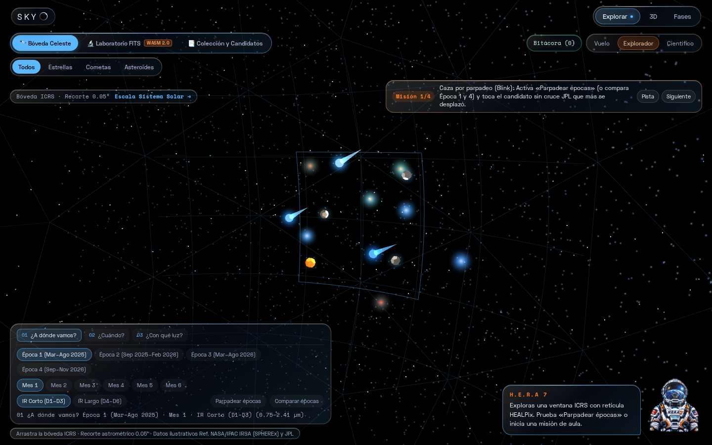
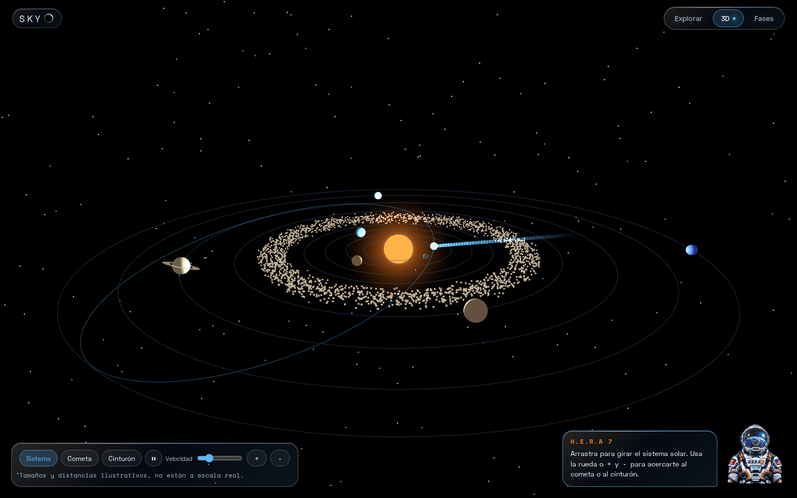

# SKYO 🌌

> **Explorador astronómico multitemporal y laboratorio científico local-first (SPHEREx / JPL / NASA)**
> Interfaz 3D con estética **Liquid Glass**, bóveda celeste ICRS, asistente **H.E.R.A 7** y procesamiento astrométrico en el navegador.

Explorar abre ahora [Dentro del cielo](inmersivo.html): panorama SPHEREx de 360° con
vuelo visual, zoom, 102 canales, HUD de coordenadas/época/flujo y WebXR.
Los valores de píxel se leen del plano FITS real mediante Worker/Rust, separados
de la apariencia PNG. [Datos, pruebas y límites](docs/VALIDACION_INMERSIVA_20261115.md).
El [plano focal D1–D6](espectral.html) y el laboratorio FITS siguen disponibles.

---

## 📸 Vista de la aplicación

| Inicio minimalista (eclipse 3D + Zoom Warp) | Bóveda Celeste ICRS |
| :---: | :---: |
|  |  |

| Sistema Solar 3D | Fases e infrarrojo multitemporal |
| :---: | :---: |
|  |  |

---

## 🎨 Paleta de campaña

| Token | Color | Uso |
|---|---|---|
| `--obsidian` | `#07070A` | Fondo, lienzo 3D y superficies base |
| `--chrome` / `--chrome-bright` | `#C9CED6` / `#E6E8EC` | Texto, bordes y reflejos metálicos |
| `--crimson` | `#E11D48` | Alertas, modo activo, candidatos y vector de movimiento |
| `--sky` | `#7CC8FF` | Acento primario, foco, enlaces y banda IR corta |

Los tokens viven en `assets/css/main.css` y se replican en `assets/css/lab.css`, `assets/js/contexto.css`, los iconos SVG y el manifiesto PWA. La documentación ampliada está en [`docs/PALETA.md`](docs/PALETA.md) y [`docs/LAYOUT.md`](docs/LAYOUT.md).

---

## ✨ Características principales

1. **Inicio cinemático (`#inicio`)**
   - Eclipse 3D de Blender (`assets/models/eclipse.glb`) como la «O» de SKYO, al pulsar «Animar eclipse 3D»; marca estática mientras no se activa.
   - Campo estelar y nebulosas reactivas al puntero, con pausa automática en reposo.
   - **Warp Zoom**: <kbd>Enter</kbd> o <kbd>Espacio</kbd> lanzan el eclipse hacia la cámara y abren la bóveda celeste.

2. **Bóveda Celeste multitemporal (`#explorar`)**
   - Coordenadas **ICRS**, retícula **HEALPix**, recorte astrométrico y filtros por tipo de cuerpo.
   - Épocas SPHEREx y bandas infrarrojas (IR Corto D1–D3 vs. IR Largo D4–D6).
   - Vistas educativas ilustrativas; las mediciones reales se abren en Laboratorio FITS.
   - Misiones guiadas de H.E.R.A 7, bitácora de candidatos y exportación JSON.

3. **Sistema Solar y Fases (`#3d` / `#fases`)**
   - Órbitas planetarias y cuerpos menores en 3D.
   - Curvas de luz, fases del proyecto y lectura espectral.

4. **Laboratorio FITS local-first (`lab.html` / `#explorar` → Laboratorio)**
   - Pipeline en Web Worker con fallback JavaScript y Rust/WASM opcional.
   - WCS TAN-SIP, máscaras FLAGS, varianza, reproyección y comparación exploratoria.
   - Botón «Cargar M101 real»: dos épocas DR1 y dos recortes con procedencia y hashes.
   - Lugar/Tiempo/Luz, blink manual, vistas A/B/diferencia/SNR, guardado y borrado local.
   - Reporte JSON del par vigente; calibración/PSF y significancia científica pendientes.
   - Contexto HiPS 2MASS de IRSA bajo demanda (`contexto.html`, Aladin Lite 3.8.2).

5. **PWA y accesibilidad**
   - Shell offline por scope, caché por versión y actualización con consentimiento.
   - Navegación por teclado, foco visible, `prefers-reduced-motion` y contraste verificado.

---

## 🚀 Inicio rápido

Requiere Node.js `^20.19.0` o `>=22.12.0` (Vite 7).

```bash
git clone https://github.com/NotMetrx/SKYO.git
cd SKYO
npm ci
npm start
```

Abre `http://127.0.0.1:4173` para la aplicación principal o `http://127.0.0.1:4173/lab.html` para el laboratorio FITS.

Para publicar en hosting estático, compila con `npm run web:build` y sirve
`dist/`. El servidor de desarrollo procesa las dependencias de Vite. Los FITS
manuales se procesan localmente; guardarlos en OPFS requiere pulsar Guardar.
Los paquetes curados se descargan solo al solicitarlos, y HiPS requiere conexión.

---

## 🧪 Compilación y pruebas

```bash
npm test                 # sesión, FITS/WCS, datos reales, OPFS y equivalencia WASM
npm run web:build        # Vite + recursos de runtime y Service Worker
npm run validate:build   # verifica dist/, manifiesto y entradas
npm run validate:docs    # verifica spec, plan, tareas y pipeline
npm run preview          # sirve dist/ en 127.0.0.1:4174
```

Pruebas de navegador (Chromium de Playwright):

```bash
npx playwright install chromium --only-shell
npm run test:browser
```

Regresiones recuperadas (también incluidas en npm test):

```bash
npm run test:science-gaps
```

Las cuatro regresiones pasan en la implementación actual. El [informe de
validación](docs/VALIDACION_IMPLEMENTACION_20261114.md) registra 43 pruebas Node,
seis Python, dos Rust, navegador, equivalencia y benchmark WASM. El
[pipeline](docs/pipelines/validacion-local.md) explica cómo repetirlas y regenerar
el kernel opcional con wasm-bindgen. T08 sigue parcial: no hay detección
astronómica validada ni prueba en Android físico. Consulta también los
[criterios científicos](docs/CRITERIOS_CIENTIFICOS_SKYO.md).

---

## 📁 Estructura del proyecto

```text
index.html, lab.html, contexto.html   Entradas Vite (portal, FITS y contexto HiPS)
sw.js                                  Service Worker (shell offline)
assets/
  css/                                 Estilos Liquid Glass (main.css, lab.css)
  fonts/                               Space Grotesk, Space Mono, Poppins
  img/                                 Assets visuales, previews y H.E.R.A 7
  js/                                  SPA: app, cosmos3d, explorar, fases, sistema3d, hera3d, data
  js/science/                          Pipeline FITS/WCS, render, worker y puente WASM
  js/vendor/                           Three.js y Lottie locales
science-core/                          Crate Rust para aceleración WebAssembly
scripts/                               Curador, generadores y suites de pruebas
public/datasets/                       Paquete visual NASA derivado publicado
data/                                  Originales FITS, calibraciones y manifiestos
docs/                                  Arquitectura, spec, auditoría, protocolos y pipelines
  specs/                               001-inicial (histórica) y 002-comparador-local (activa)
  pipelines/                           Validación local y visual
  protocols/                           PV-01…PV-08 de auditoría visual
_archivo/                              Material legacy y skills de referencia
MEMORY.md, AGENTS.md                   Memoria operativa y protocolo vigente
```

`tools/postbuild.mjs` y `vite.config.mjs` se conservan activos en la raíz para la compilación; sus copias históricas están en `_archivo/legacy/`.

---

## 📚 Documentación

- [SPEC principal](docs/SPEC_SKYO_2.1_AUDITADO.md)
- [Constitución del proyecto](docs/constitution.md)
- [Interfaz y UX](docs/INTERFAZ-Y-UX.md)
- [Paleta](docs/PALETA.md) y [layout](docs/LAYOUT.md)
- [Criterios científicos](docs/CRITERIOS_CIENTIFICOS_SKYO.md)
- [Pipeline de validación local](docs/pipelines/validacion-local.md)
- [Validación de implementación T01–T08](docs/VALIDACION_IMPLEMENTACION_20261114.md)
- [Protocolos de auditoría visual](docs/protocols/README.md)
- [Fuentes y procedencia](docs/FUENTES.md)
- [Roadmap](docs/ROADMAP.md)

---

## ⚡ Rendimiento y buenas prácticas

- **Sin polling inútil**: la lógica se activa por eventos (`pointermove`, `keydown`, `hashchange`).
- **Pausa automática**: al ocultar la pestaña, los bucles 3D suspenden CPU/GPU.
- **Accesibilidad**: `prefers-reduced-motion`, foco visible y alternativa no cromática.
- **Autonomía**: Three.js y Lottie se sirven localmente; la app funciona sin CDN.

---

## 📜 Licencia

Distribuido bajo la licencia [MIT](LICENSE).
