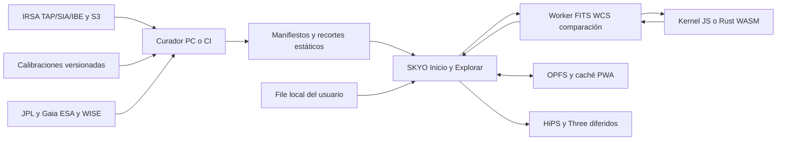

# SKYO 2.1 — SPEC principal para iniciar implementación

> **Revisión:** preparación técnica y científica, 2026-11-13 (America/Lima).
> **Estado del documento:** requisitos y plan de arranque definidos; la edición y las pruebas fueron solicitadas por el usuario. No representa aprobación automática de la mente general.
> **Estado del producto:** laboratorio exploratorio existente con fallos conocidos; no aceptado como detector astronómico ni como aplicación de producción.
> **Referencia única de producto:** este archivo. `specs/001-inicial/` documenta la incorporación administrativa, no los requisitos científicos.
> **Objetivo:** herramienta pública de exploración temporal SPHEREx para el reto «Planet X and SPHEREx». No es un producto oficial de NASA/JPL/IPAC.

## 0. Qué se construye y qué permite empezar

SKYO permitirá elegir **Lugar, Tiempo y Luz**, ver el contexto del cielo, abrir observaciones reales con procedencia y comparar dos épocas compatibles. La aplicación interactiva funcionará en el dispositivo del visitante, con hosting estático, un Worker científico y fallback JavaScript; Rust/WASM será una optimización medible. El procesamiento de curación y las consultas pesadas se harán previamente en PC/CI, sin un VPS permanente.

Se conserva la dirección de interfaz de SKYO: navegación Inicio/Explorar/3D, H.E.R.A 7 contextual, español, accesibilidad y 3D diferido. El código original de esa interfaz y `SPEC(1).md` **no están en este árbol**: su integración no se declara revisada. El punto de partida ejecutable es el laboratorio independiente de `web/`; disponer del frontend original es dependencia de su integración, no impide empezar por datos, contratos y correcciones del laboratorio.

**Listo para comenzar** significa que hay fuente principal, requisitos comprobables, contratos, fuentes de datos, tareas ordenadas y pruebas con resultado real. No significa que todos los requisitos estén implementados ni que se hayan validado descubrimientos. Primero se resolverán los fallos de procedencia y concurrencia; después se integrarán datasets reales y la experiencia completa.

**Fuera del primer entregable:** búsqueda autónoma de Planeta X, órbitas nuevas, LLM obligatorio, servidor propio, entrenamiento de IA, descarga masiva del cielo, WebGPU obligatorio y migración de framework. La detección de candidatos tendrá una puerta de aceptación separada. Una diferencia visual también puede ser ruido, banda distinta, PSF, paralaje o variabilidad.

Plan y seguimiento: [plan](specs/002-comparador-local/plan.md), [tareas registradas](specs/002-comparador-local/tareas-plan.md) y [validación de preparación](specs/002-comparador-local/validacion.md).

La versión previa se conserva en [archivo histórico](docs/archive/SPEC_SKYO_2.1_ANTES_PREPARACION_2026-11-13.md). La [auditoría inicial](docs/AUDITORIA_SPEC_2026-11-13.md) describe el snapshot anterior; la evidencia y los resultados actualizados se incorporan en §11.

## 1. Usuarios, requisitos verificables y alcance por etapa

Usuarios: visitante que compara imágenes sin formación técnica; explorador que consulta fechas, bandas y fuentes; equipo científico que necesita reproducir resultados y descartar artefactos. El mismo conjunto de observaciones debe sustentar la vista, el cálculo y el reporte.

Cada RF usa una condición y una salida observable. **I** = base e integridad; **V** = comparador visual real; **C** = ciencia de candidatos posterior. Los RF de v1 mencionados en la revisión histórica no se consideran trazados hasta recibir esa fuente.

| ID | Requisito EARS | Etapa / aceptación mínima |
|---|---|---|
| RF-01 | CUANDO se abra Inicio, EL SISTEMA mostrará interfaz y acceso a Explorar sin descargar FITS ni ejecutar análisis pesado automáticamente. | I: traza de red y CPU sin imágenes científicas de fondo |
| RF-02 | CUANDO se navegue o se usen controles, EL SISTEMA permitirá teclado, foco visible, lectura de estados y diseño sin overflow a 360/390 px. | V: recorrido manual y navegador con viewport móvil |
| RF-03 | CUANDO se ingiera un archivo o manifiesto, EL SISTEMA validará su esquema, integridad y procedencia antes de asignar NASA-ORIGINAL/NASA-DERIVED; sin evidencia suficiente usará USER-LOCAL. | I: hash erróneo rechazado, manifiesto incompleto controlado y NASA derivada nunca etiquetada sintética por ORIGIN |
| RF-04 | CUANDO se prepare un dataset NASA, EL CURADOR conservará release, versión, identificación, tiempos, URLs, hashes y transformaciones de cada observación. | I: ida y vuelta con VERSION y HDU conservadas/omitidas documentadas |
| RF-05 | SI IRSA responde con un fallo transitorio, EL CURADOR reintentará de forma acotada y reportará fallo parcial sin confundirlo con ausencia de cobertura. | I: 429/503/timeout ensayados; Retry-After respetado |
| RF-06 | CUANDO se seleccione un par real, EL SISTEMA comprobará IDs distintos, tiempos distintos, solapamiento espacial, calibración compatible y bandas según §4. | V: dos observaciones reales reproducibles; duplicados rechazados como cambio temporal |
| RF-07 | CUANDO se lea FITS, EL SISTEMA validará estructura, tamaños, unidades, dimensiones y formatos; rechazará funciones no soportadas sin inventar capas. | I: truncado, compresión desconocida y dimensiones abusivas fallan de forma recuperable |
| RF-08 | CUANDO se aplique calidad, EL SISTEMA usará máscaras versionadas por propósito, conservará datos originales y no eliminará SOURCE del análisis por defecto. | I/V: bits altos y nombres reales, incluida SATELLITE_HALO, verificados |
| RF-09 | CUANDO se registre espacialmente un par, EL SISTEMA aceptará solo WCS y unidades soportados y demostrará consistencia frente a Astropy. | I/V: RA/Dec TAN(-SIP); otros ejes/unidades rechazados; tolerancias de §11 |
| RF-10 | CUANDO se use longitud de onda, EL SISTEMA distinguirá estimación visual WCS-WAVE de calibración científica CWAVE/CBAND y conservará origen/coordenadas del mapa. | V/C: ausencia de calibración científica impide subir el nivel del análisis |
| RF-11 | CUANDO se estime fondo o se reste ZODI, EL SISTEMA lo hará en copias temporales, registrará método y exclusiones y preservará IMAGE original. | V: modo/modelo explícito, SOURCE excluida del fondo de A y B |
| RF-12 | CUANDO se calcule diferencia/SNR, EL SISTEMA propagará la varianza según el remuestreo y declarará los términos de incertidumbre omitidos. | V: fixtures independientes y controles de nulos/varianza; SNR no es probabilidad de descubrimiento |
| RF-13 | SI llegan cargas o resultados antiguos, EL SISTEMA impedirá que modifiquen entradas, vista, comparación o reporte vigentes. | I: prueba de llegada job 3 → job 1; cancelación/invalidez de snapshot |
| RF-14 | CUANDO se exporte un análisis, EL SISTEMA incluirá ambas observaciones, parámetros, versiones, máscaras, calibraciones y limitaciones bajo un único contrato validado. | I/V: reabrir/recalcular el mismo par sin inferir qué archivos se usaron |
| RF-15 | CUANDO el usuario guarde, reabra o borre datos locales, EL SISTEMA gestionará consentimiento, cuota y fallos sin presentar una pareja parcialmente escrita como válida. | V: fallo durante segundo archivo, cuota y recuperación offline probados |
| RF-16 | CUANDO se publique el bundle, EL SISTEMA cargará Worker y WASM opcional desde raíz y subdirectorio, con fallback explícito y caché offline coherente. | I/V: build, HTTP 200 de assets, errores recuperables y prueba de actualización SW y cabeceras Vary: Origin |
| RF-17 | CUANDO una fuente se catalogue como conocida, EL SISTEMA conservará consulta, catálogo, versión, época, observador e incertidumbre que sustentan la asociación. | C: JPL para cuerpos menores, Gaia para estrellas; ninguna ausencia equivale a descubrimiento |
| RF-18 | CUANDO se sugiera un candidato, EL SISTEMA exigirá validación independiente, PSF, calibraciones y controles de falsos positivos. | C: inyección/recuperación y controles negativos; no basta SNR fijo ni >2 arcsec |
| RF-19 | CUANDO H.E.R.A 7 explique o el 3D se active, EL SISTEMA distinguirá mediciones de ilustraciones y detendrá actividad cuando no sea visible. | V: fuentes en explicación, pausa demostrada; HERA determinista primero |
| RF-20 | CUANDO una operación exceda el presupuesto soportado, EL SISTEMA avisará y rechazará o reducirá la ROI con consentimiento, sin degradar datos silenciosamente. | I/V: límites medidos de §9; importación excesiva sin bloqueo/crash |

## 2. Arquitectura y decisiones de implementación

Las siguientes decisiones son la base de esta especificación, no registros de aprobación humana en MCP.

| ADR | Decisión | Consecuencia comprobable |
|---|---|---|
| 01 | Vite + ES Modules y DOM; TypeScript/JSDoc progresivo | Reutilizar módulos actuales; no añadir React/Svelte solo por una skill |
| 02 | Un Worker científico; Rust/wasm-bindgen opcional | JS es ruta válida; medir equivalencia antes de anunciar motor WASM |
| 03 | Canvas 2D y WebGL2 para vistas; Three.js diferido | No modificar matrices al ajustar contraste; liberar GPU fuera de vista |
| 04 | Aladin Lite v3 para contexto HiPS | Fijar versión/licencia/notices; mapa mosaico separado de comparación temporal L2 |
| 05 | OPFS para archivos, IndexedDB solo cuando haya un índice necesario | No crear backend/Redis/PostgreSQL; manejar cuota y borrado |
| 06 | Hosting estático HTTPS y PWA | Recortes curados del mismo origen + archivos manuales como ruta garantizada |
| 07 | Curación PC/CI y paquetes estáticos | Consultas NASA/JPL pesadas fuera del navegador; sin credenciales en cliente |
| 08 | DR1 + QR3 como conjunto de trabajo | No mezclar QR2 sin evaluación explícita de calibración |
| 09 | HERA determinista y contextual | No inventar valores ni depender de un LLM para el MVP |
| 10 | Sin multithreading WASM inicial | COOP/COEP/SharedArrayBuffer solo si una medición lo justifica y no rompe HiPS |



Main thread: interfaz, accesibilidad, consentimiento y OPFS asíncrono. Worker: parseo, WCS y matrices. `FileSystemSyncAccessHandle` es exclusivo de Dedicated Workers; no obliga a mover toda API OPFS asíncrona a un Worker. Los ArrayBuffer transferidos quedan detached; conservar File o persistir antes de transferir. El worker no descarga datos de un endpoint que no permite CORS por el hecho de ser Worker/WASM.

## 3. Qué datos se aceptan y cómo se representan

### 3.1 Productos separados

| Producto | Uso en SKYO | Regla |
|---|---|---|
| MEF L2 de una observación/detector | Comparación por época | Fecha real, seis extensiones y PRIMARY; no tratarlo como 102 épocas |
| Recorte de MEF servido por IRSA | Ingesta pequeña con WCS | Sigue siendo derivado del MEF; registrar parámetros y URL del padre |
| HiPS/All-Sky Cube DR1 | Contexto y selección λ | Mosaico multiexposición, no una época; máscara de disponibilidad |
| Calibración Spectral WCS | Análisis espectral científico | CWAVE/CBAND y correspondencia de coordenadas/versiones |
| Transmisiones espectrales de laboratorio | Evaluar respuesta/color cuando proceda | No confundir con las calibraciones usadas por el pipeline |
| Catálogos/efemérides externos | Contrapartes y validación | Documentar catálogo y geometría; Gaia es ESA |
| Simulación local | Demos y pruebas | sourceKind SYNTHETIC; nunca release NASA inventado |

DR1 y QR3 reemplazan a QR2 para trabajo nuevo; la documentación de releases está fechada 12/11/2026 y el release DR1 se describe como noviembre de 2026. No se infiere una hora exacta de anuncio. DOI: [imágenes DR1](https://doi.org/10.26131/IRSA678) y [cubo DR1](https://doi.org/10.26131/IRSA679). Fuente: [overview IRSA](https://irsa.ipac.caltech.edu/data/SPHEREx/docs/overview_dr1.html).

### 3.2 Capas, coordenadas y calidad

- PRIMARY: conservar VERSION y metadatos relevantes; DATE de procesamiento no sustituye fecha observada.
- IMAGE: brillo superficial MJy/sr; conservar BUNIT. VARIANCE: unidades cuadradas. Los mapas ZODI del L2 no se han restado de IMAGE. No sumar radiancias como si fueran flujo integrado de fuente.
- FLAGS: bitmap entero de 32 bits del producto de imagen. Puede venir comprimido en el original y sin comprimir en un recorte; comprobar el HDU real. MSKN/MSKD son las definiciones por archivo.
- EPSF: leer detector y geometría de zonas; no fijar universalmente 441 filas. La geometría publicada actualmente para D3 es 11×41=451 y para los otros detectores 21×21=441; en el archivo también coexisten calibraciones D3 v1 de 441 filas y v2 de 451. Resolver la versión realmente asociada al MEF; no inferirla solo del detector. El producto derivado visual puede omitir EPSF para reducir tamaño, pero debe declarar la omisión y cómo recuperar la referencia científica.
- WCS-WAVE: mapa aproximado de centro/ancho de banda para visualización. Su presencia o su lectura por píxel **no validan ciencia espectral**. El análisis científico usará CWAVE/CBAND de la calibración Spectral WCS, ligada a la versión de la observación.

Estas distinciones se basan en [productos SPHEREx](https://caltech-ipac.github.io/spherex-archive-documentation/spherex-data-products/). Hay instrucciones QR2 antiguas dentro de algunas páginas: resolver discrepancias por release, versión y cabeceras reales, sin trasplantar un lector de PSF antigua al EPSF de DR1. [Tutorial ePSF](https://caltech-ipac.github.io/irsa-tutorials/spherex-psf/).

Las calibraciones y los recortes deben referirse a los mismos píxeles del detector padre. Registrar `CRPIX1A/CRPIX2A`, recorte y orientación; verificar flips en vez de aplicarlos por intuición. Para pasar de píxel 0-based del recorte al padre se contrastará `1 + x_cutout - CRPIX1A` y su equivalente Y con Astropy. Las transmisiones de laboratorio en detector coordinates advierten flips X para D4–D6; no aplicar esa regla ciegamente a otro producto. [Calibraciones espectrales](https://irsa.ipac.caltech.edu/data/SPHEREx/docs/spherex_spectral_calibrations.html).

**Máscaras por propósito:** versión de política, nombres/bits elegidos y motivo en el reporte. SOURCE se excluye de la estimación de fondo de ambas épocas, no de los píxeles de fuente a analizar. Una máscara visual conservadora no equivale a la receta de fotometría de IRSA. Incluir SATELLITE_HALO cuando exista, conservar bits desconocidos y marcar política incompleta en vez de ignorarlos. No aplicar operadores JS de 32 bits a flags de catálogos: la salida fotométrica puede incluir el bit 32, que requiere BigInt/entero de mayor tamaño o un formato textual sin pérdida. [Documentación de fotometría y flags](https://irsa.ipac.caltech.edu/onlinehelp/spherex/spherex/sp.html).

**HiPS:** consultar `properties`, `BLANKCH`/disponibilidad del producto y lista λ; no convertir un hueco en señal cero. Los índices visuales base 0 son distintos de los números de canal base 1. El producto consultado tiene 102 planos nominales y vacíos 50/51 base 0 (51/52 base 1); también puede tener artefactos de mosaico. Los PNG son para visualización. [Tutorial HiPS](https://caltech-ipac.github.io/irsa-tutorials/spherex-hipscube/).

### 3.3 Contrato normativo de procedencia y del dataset

El `.d.ts` actual es **una referencia parcial**, no una validación de runtime implementada. Se mantendrá un solo esquema de dominio, con adaptador explícito para el manifiesto actual snake_case. Los nombres persistidos de estado serán en inglés y la interfaz traducirá etiquetas al español.

Datos mínimos por observación:

| Grupo | Campos obligatorios o regla de nulidad |
|---|---|
| Identidad | id estable, datasetId, sourceKind; original observation_id/plane_id y detector cuando sea NASA |
| Procedencia | dataRelease DR1/QR3 o null; collection exacta, sourceUrl y parentMefUrl, retrievedUtc, processingVersion, curatorVersion |
| Integridad | sha256 del archivo cargado; sourceSha256 de los bytes descargados; hash del MEF padre solo si se obtuvo, nunca inventarlo |
| Tiempo | mjdStart/mjdEnd/mjdMid y timeScale de la fuente; observedUtc; conservar las tarjetas nativas y la política de derivación |
| Espacio | centro/footprint ICRS, dimensiones, WCS y unidades, transformación al detector padre |
| Espectral | lambdaCenterUm/bandwidthUm orientativas; spectralCalibrationId/version/url/hash y nivel de fidelidad; mapa/cobertura cuando exista |
| Calidad | flagsDefinitions, maskPolicyId/version, HDU disponibles/omitidas, bytes, problemas por píxel y banderas de soporte |
| Transformaciones | origen del recorte, parámetros, pasos y software; manifestVersion y lista de advertencias |

`sourceKind`: NASA-ORIGINAL solo para bytes del MEF oficial intacto; NASA-DERIVED para recortes/derivados con cadena trazable; USER-LOCAL cuando no puede verificarse; SYNTHETIC solo por flujo explícito de demostración. Para USER-LOCAL y SYNTHETIC, colección, URLs, IDs NASA, calibraciones y tiempos no conocidos serán null con motivo, nunca inventados; SYNTHETIC puede tener tiempos ficticios rotulados como simulados. Para NASA-DERIVED, la cadena de procedencia y el hash del recorte sí son exigibles; el hash del MEF padre y campos científicos no disponibles admiten null documentado. Un perfil visual admite calibración científica ausente; science-ready-inputs no admite omitir las calibraciones/PSF que el experimento requiere.

Un SHA confirma integridad respecto de un manifiesto, **no autentica por sí solo un manifiesto arbitrario del usuario**. Confiar en el paquete curado del equipo o en una recuperación verificada de la fuente permitida; no en el nombre del archivo ni en ORIGIN. Validar tipos, valores finitos, límites, versiones, fechas y URLs HTTPS de procedencia; no ejecutar HTML/scripts de metadatos.

Calidad astrométrica: conservar `FINAST` de IMAGE y `quality_flag` de metadatos sin considerar un valor vacío como aprobado. El suplemento v2.1 describe FINAST=0 bueno, 1 parcial y otros malos: una imagen parcial solo se usa con advertencia en exploración y con presupuesto de error explícito antes de ciencia. Fuente fijada en el [recibo del suplemento](docs/evidence/investigacion-nasa-20261113/expsupp-receipt.json).

Tiempos: `time_bounds_lower` sirve para descubrimiento/orden, no es automáticamente el instante representativo de una efeméride. Conservar intervalo; preferir MJD-AVG del producto cuando corresponda al centro de integración. Si se deriva (start+end)/2, registrar que se derivó. Si falta escala o geometría, no emitir asociación astrométrica precisa; no sobrescribir DATE-OBS original para ocultar diferencias de redondeo.

Dos perfiles estáticos:

```text
web/public/datasets/<datasetId>/
  manifest.json                 # lista y hashes, perfil visual o científico
  observations/*.fits          # derivados visuales o recortes conservados
  calibrations/*               # solo ROI/mapas necesarios, con procedencia
  references/*                 # catálogos/efemérides acotados y versionados
  pair-selection.json          # por qué A/B, cobertura, bandas, exclusiones
```

Perfil `visual`: permite EPSF/calibración científica ausentes con advertencias; solo exploratorio. Perfil `science-ready-inputs`: todas las entradas necesarias están trazadas, pero **no certifica** por sí mismo el algoritmo ni un candidato. Conservar originales fuera de `dist/` o referencias exactas recuperables; no precachear un archivo completo grande por defecto.

## 4. Acceso NASA, curación y selección reproducible

### 4.1 Servicios y colecciones concretos

| Servicio | Endpoint o fuente | Uso soportado |
|---|---|---|
| TAP | `https://irsa.ipac.caltech.edu/TAP/sync` | Metadatos de artifact/plane/observation; trabajo del curador |
| SIA2 | `https://irsa.ipac.caltech.edu/SIA` | Consultar cada colección y guardar access_url/cloud_access |
| L2 wide | spherex_dr1, spherex_qr3 | Épocas individuales del survey amplio |
| L2 deep | spherex_dr1_deep, spherex_qr3_deep | Cobertura adicional, opt-in, puede aumentar volumen |
| Cubo | spherex_dr1_cube | Contexto mosaico; nunca usarlo como dos visitas independientes |
| IBE | access_url de TAP/SIA + center/size | Recorte espacial del MEF con HDU/WCS |
| HiPS | `https://irsa.ipac.caltech.edu/data/hips/SPHEREx/spherex_allsky_cube/properties` | Descubrir canales y visualización ligera |
| S3 | cloud_access devuelto por SIA y guía oficial | Alternativa anónima para curación/rangos cuando el servicio lo soporte |
| Calibraciones | Productos y referencias del release | No disponibles por SIA2; resolver archivos exactos/versión por guía/cabeceras |

La [guía de acceso](https://caltech-ipac.github.io/spherex-archive-documentation/spherex-data-access/) distingue consultas SIA de metadatos/calibraciones y advierte un retraso aproximado de un día en SIA respecto a ingesta. Un directorio web 404 no demuestra que access_url sea inválida; consultar la URL de archivo concreta. CORS se prueba por recurso y origen: HiPS/S3 pueden admitirlo aunque TAP/IBE no lo hagan. No extrapolar la cabecera de un host a todos sus servicios.

Consulta TAP de referencia para el curador, con RA/Dec/detector validados numéricamente y parámetros de tamaño controlados:

```sql
SELECT TOP 200
  ar.uri, ar.planeid, p.obsid, o.observationid, o.collection,
  p.time_bounds_lower, p.time_bounds_upper, p.energy_bandpassname,
  p.provenance_version
FROM spherex.artifact ar
JOIN spherex.plane p ON ar.planeid = p.planeid
JOIN spherex.observation o ON o.obsid = p.obsid
WHERE 1 = CONTAINS(POINT('ICRS',210.80227,54.34895),p.poly)
  AND p.energy_bandpassname = 'SPHEREx-D2'
  AND o.collection IN ('spherex_dr1','spherex_qr3')
ORDER BY p.time_bounds_lower, ar.planeid
```

Guardar tanto el UUID `p.obsid` como el nombre legible `o.observationid`: no son intercambiables al filtrar una exposición. Filtrar release **antes** del límite; deduplicar por observación/producto, no por fecha de descarga. TOP 200 es una consulta acotada, no prueba de cobertura exhaustiva. Si se alcanza el límite, paginar o partir ventanas de tiempo con desempate estable; marcar resultado potencialmente truncado. En producción fijar también MAXREC y preferir VOTable para inspeccionar QUERY_STATUS=OK/ERROR/OVERFLOW: HTTP 200 no garantiza éxito y TOP por sí solo no activa la señal de overflow de TAP. Para incluir deep, consultar sus colecciones explícitamente. El [tutorial oficial de recortes](https://caltech-ipac.github.io/irsa-tutorials/spherex-cutouts/) aporta el patrón artifact+plane y center/size.

SIA BAND se expresa en metros y filtra rangos de imagen, no la respuesta de una fuente en su píxel; TIME usa MJD. No confundir ese filtro de descubrimiento con RF-10.

Formar la URL a partir de access_url/uri documentada mediante un constructor de query, no concatenar otra `?` a una URL con parámetros. `center=RA,Decd&size=lado_deg` especifica una caja angular, no garantiza 128×128 píxeles ni un tamaño en bytes. La API documenta también tamaños en píxeles (`size=128pix`), útiles para pedir una ROI ligada al presupuesto; verificar el recorte devuelto y sus bordes igualmente. Verificar producto recibido, resolución, dimensiones, HDU y footprint después de descargar. [Parámetros IBE](https://irsa.ipac.caltech.edu/ibe/cutouts.html).

### 4.2 Robustez de la curación

1. Consultar metadatos con límites, timeout y recibo de consulta. Cachear respuestas de trabajo de forma explícita.
2. Descargar de forma secuencial por defecto; concurrencia máxima inicial 2, como **decisión operativa del proyecto**, no límite publicado de NASA.
3. Ante 429/503/timeouts/conexión cortada: hasta 3 intentos totales por archivo; sin Retry-After usar esperas propuestas de 5 y 10 s dentro del presupuesto; respetar Retry-After y presupuesto total del job. Si el servidor pide una espera fuera del presupuesto, pausar y registrar próximo intento. No reintentar indefinidamente 404/esquema inválido. Es política propuesta que deberá probarse.
4. Descargar a temporal con límite de bytes y comprobar respuesta FITS, checksum disponible, tamaño y hash; no guardar un HTML de error con extensión .fits.
5. Guardar por identidad/hash sin sobrescribir silenciosamente datasets existentes; publicar el manifiesto solo después de cerrar/verificar archivos. Interrupción conserva el dataset previo íntegro.
6. Conservar PRIMARY.VERSION, tiempos nativos, EPSF o referencia/omisión y calibraciones. No alterar radiancias/FLAGS para mejorar una demostración; cada conversión es un derivado.
7. Calcular estadísticas de cobertura/calidad y mapas espectrales. Seleccionar pareja después, no «los dos primeros archivos descargados».
8. Terminar con `complete`, `partial` o `failed` y lista de errores. Una sola época puede servir para inspección, nunca para afirmar comparación temporal lista.

El curador actual aún no implementa toda esta política. En la auditoría, descargas válidas alternaron 503 y 200; respetar ese límite real de disponibilidad. Descubrir la key exacta de calibración desde cabeceras/listado o registro oficial; la guía ilustra cal-wcs, mientras el listado real consultado usa cal-swcs-v5-2026-191. Versionar esa resolución y el hash; ETag no sustituye SHA-256.

S3 con soporte Range permite inspeccionar cabeceras sin bajar ~65 MB, pero no sustituye por sí solo al recorte espectral/PSF correcto.

### 4.3 Dataset inicial y reglas para emparejar

- **Fixture real de ingeniería:** M101, RA 210.80227°, Dec 54.34895°, D2. Ya hay consulta y recorte real comprobados. Sirve para parser/WCS/procedencia; **no es un blanco de movimiento garantizado**.
- Preparar primero 2–5 regiones pequeñas con un par válido por región y un control negativo. El manifiesto conservará candidatas rechazadas y motivos.
- Para cambio temporal: dos IDs y tiempos distintos; registrar Δt sin imponer universalmente 14 días. La cadencia útil depende de movimiento/variabilidad y cobertura. El valor actual `--min-gap-days=14` no es un requisito científico.
- Exigir solapamiento espacial útil y unidades/calibración comparables. Para MVP soportar mismo detector como restricción de implementación; «detector distinto» no se presentará como prueba física universal de incompatibilidad.
- Emparejar por λ y respuesta en la zona común. El filtro actual `|λA−λB|≤0.25·min(ΔλA,ΔλB)` es **heurística de preselección**, no una norma NASA ni validación científica. Registrar qué parte de la ROI la cumple; sin mapas científicos, solo exploratorio.
- Para fuentes móviles, evaluar la respuesta en cada posición/época de la fuente y el efecto de su espectro. Misma λ central en el centro geométrico no basta para toda la imagen.
- No confundir exposición distinta con calibración diferente, mismo evento duplicado o distinto producto de la misma visita. Conservar la política de agrupación por época y resultados individuales.
- **Demostración móvil posterior:** la [página IRSA de 3I/ATLAS](https://irsa.ipac.caltech.edu/data/SPHEREx/docs/comet3iatlas/index.html) aporta posiciones predichas, pero la tabla consultada aún tiene 259 filas QR2 y enlaces DataLink. Resolver sus observationid en DR1/QR3 antes de descargar; no tratar DataLink como FITS ni prometer visibilidad. Se resolvió una exposición histórica a seis detectores DR1, sin certificar aún un par, fotometría o movimiento. El cometa puede ser extendido/tenue: no usarlo como control de fotometría puntual.
- Blancos educativos de alto movimiento/variabilidad se elegirán después de verificar señal y cobertura en datos reales, sin prometer visibilidad por aparecer en una lista del reto. El enlace de recursos oficiales del reto deberá adjuntarse cuando sea recuperable.

## 5. Pipeline y controles científicos

### P1. Validar e identificar

Aplicar RF-03/04/07 antes de procesar. Las cuatro capas 2D deben tener dimensiones compatibles y tamaño permitido. NaN/BLANK no se convierten en ceros válidos. Rechazar HDU truncadas, dimensiones negativas, productos desconocidos y BZERO/BSCALE no soportados. FLAGS32 va a Uint32Array, jamás Float32Array. Si hay tile compression no soportada, explicar que falta lector o derivado; no hacerla pasar por FLAGS=0.

### P2. Separar calidad, espectro y registro

Generar máscaras de visualización, fondo y análisis con políticas registradas. Validar ejes `RA---TAN`/`DEC--TAN` o `RA---TAN-SIP`/`DEC--TAN-SIP`; aceptar grados o valor por defecto FITS documentado si CUNIT falta, y rechazar explícitamente radianes u otras proyecciones/ejes no implementados. Conservar y validar RADESYS/EQUINOX: RA/Dec TAN no garantiza ICRS. T03 soportará un marco explícito y rechazará FK4/FK5 u otros si no hay transformación implementada/verificada. La ausencia de esas tarjetas solo puede resolverse por el default del estándar FITS aplicable, registrado y ensayado; nunca interpretar coordenadas galácticas como ecuatoriales.

Los coeficientes SIP se aplican al WCS espacial; el WCS alternativo W usado por Astropy para estimación espectral se evalúa sin SIP, como en el [tutorial de imágenes](https://caltech-ipac.github.io/irsa-tutorials/spherex-intro/). Para ciencia, mapear CWAVE/CBAND de calibración al detector padre y la ROI. No etiquetar `wavelengthMapVerified=true` por tener dos escalares positivos.

### P3. Reproyectar sin destruir el dato

Mantener los originales y generar B sobre la cuadrícula A con máscara y metadatos de transformación. Bilineal es la ruta exploratoria actual. Verificar bordes, cobertura, convergencia e índices 0-based/1-based. Si se pretende fotometría, añadir validación de conservación de flujo y tratamiento del área sólida de píxel; MJy/sr y µJy no son intercambiables.

### P4. Fondo, PSF e incertidumbre

El prototipo resta ZODI cuando ambos mapas existen y ajusta un plano residual robusto; falta incorporar incertidumbre del modelo. El ajuste requerido excluirá SOURCE de ambas épocas del fondo, con su máscara reproyectada; las fuentes permanecerán disponibles para el análisis. El código actual solo considera SOURCE de A: T04 debe completar el tratamiento de B. Si se ofrece conmutador de ZODI, el contrato compare registrará ese parámetro; **el protocolo actual no lo expone**. Si no se expone, informar honestamente el comportamiento automático actual.

No sustraer ZODI de nuevo a un producto que ya lo tenga restado, como el cubo DR1. La ruta de diferencia por épocas usa L2. La fotometría de referencia de IRSA ajusta fuente y fondo local y no usa ZODI como sustituto del fondo; comparar los métodos, no afirmar equivalencia con el plano del prototipo. Para convertir brillo superficial a flujo usar calibración de ángulo sólido y PSF. [Fotometría oficial](https://irsa.ipac.caltech.edu/onlinehelp/spherex/spherex/sp.html).

Para el kernel exploratorio:

```text
D = A_preparada − B_reproyectada − plano_residual
Var(B_reproyectada) = Σ(w_i² · Var(B_i)), si errores de entrada independientes
SNR_aproximado = D / sqrt(Var(A) + Var(B_reproyectada))
```

Registrar las omisiones: covarianza inducida por remuestreo, PSF, fondo ajustado, calibración y ZODI. Después de matching PSF, la varianza debe seguir los pesos del kernel y sus correlaciones; no reutilizar ciegamente la fórmula anterior. Un mapa SNR con esos términos omitidos no es significancia calibrada.

### P5. Detección e identificación — etapa C

No usar `>2 arcsec`, un SNR universal ni ausencia en catálogo como criterio suficiente. Exigir PSF espacial, asociar detecciones entre épocas, medir errores, inyectar señales con verdad conocida y controles negativos. Separar movimiento propio, paralaje, variabilidad y cambios de respuesta espectral. Fijar umbrales experimentales solo tras medir completitud y falsos positivos; incluir incertidumbres y condiciones del experimento.

JPL: SB Identification para cuerpos menores en un campo; Horizons para predicción en tiempos/geometría correctos; SBDB para identidad y órbita, no como detector de todas las fuentes. Guardar observador SPHEREx, sistema de referencia, intervalo/midpoint, consulta y respuesta. Las tarjetas X_SC/Y_SC/Z_SC y velocidades no se envían automáticamente como ICRF: confirmar orientación, unidades y época; GEOCENTER acredita el origen, no la orientación. Para SB Identification, `xobs` exige estado geocéntrico ICRF compatible; para Horizons registrar CENTER, REF_SYSTEM, TLIST_TYPE y escala temporal. Si se usa un observador aproximado por falta de estado orbital, el resultado seguirá siendo exploratorio; no sustituir silenciosamente SPHEREx por geocentro. [SB Identification](https://ssd-api.jpl.nasa.gov/doc/sb_ident.html), [Horizons](https://ssd-api.jpl.nasa.gov/doc/horizons.html), [SBDB](https://ssd-api.jpl.nasa.gov/doc/sbdb.html).

Gaia: propagar posiciones/errores desde la época de catálogo con movimiento propio y paralaje/velocidad radial cuando estén disponibles y sean necesarios; no dibujar una posición de catálogo sin fecha como si fuera contemporánea. AllWISE: contraparte infrarroja y referencia histórica; no usar sus motions como predictor fiable de otra época sin evaluación, pues mezclan movimiento propio/paralaje. [Gaia ESA](https://www.cosmos.esa.int/web/gaia/data-access), [advertencias AllWISE](https://irsa.ipac.caltech.edu/data/WISE/docs/release/AllWISE/expsup/sec2_6.html).

Estados `candidate-unverified` y `catalog-matched` indican interpretación experimental, no descubrimiento ni certeza absoluta. Los no detectados, ambiguos y errores de catálogo se conservan como tales. La publicación de un hallazgo requiere revisión independiente, fuera de este MVP.

## 6. Interfaz y experiencia

- Inicio: identidad y CTA; contexto ilustrativo marcado; sin FITS en la primera carga.
- Explorar: Lugar/tiempo/λ, contexto HiPS y filtro de disponibilidad. El usuario distingue mosaico, observación L2, derivado y simulación antes de interpretar cambios.
- Laboratorio: A/B, fechas e intervalo, banda/fidelidad, fuente/release/versión, máscara y advertencias. Elegir par, blink manual o reproducido, diferencia y SNR; no forzar blink de un par incompatible.
- Exportar: reporte completo y explícito sobre qué observaciones siguen vigentes. Deshabilitar exportación antigua inmediatamente al cargar otro archivo o cambiar parámetros.
- HERA: explica los campos reales del reporte y ofrece enlaces; si falta algo dice que falta. No genera una medida a partir de una imagen artística.
- 3D: diferido; órbitas JPL verificadas solo si hay geometría y época; resto ilustrativo rotulado. Carga/animación suspendida al ocultarse.

Mantener CSS y componentes existentes. Tokens propuestos: fondo #080D1B, superficie #111A2C, acento #8DE8FA y alerta #F4BC74; comprobar contraste, no asumirlo por el color. Fuente local con 2–3 pesos; no añadir librerías UI por una recomendación de skill. Controles táctiles objetivo 44×44 px, foco visible, nombres accesibles, aria-live para operaciones y errores, alternativa no cromática y reduced-motion sin blink/rotación automáticos. Objetivo WCAG 2.2 AA, verificado por recorrido y herramientas; no declarado cumplido por inspección visual solamente.

## 7. Protocolo, concurrencia y reporte

Conservar eventos `load`, `compare`, `render`, `clear` y `jobId`, pero formalizar además el snapshot de entradas. `load` incluye side, observation y buffer; compare devuelve las identidades/versiones de A/B usadas. Los tipos de dominio no serán simples Record<string,unknown> para los datos científicos. No introducir un segundo RPC paralelo.

Reglas obligatorias:

1. Cada lado tiene su versión de selección y última carga. Antes y después de file.arrayBuffer/hash comprobar vigencia; el Worker también rechaza versiones antiguas. No basta con ignorar loaded en main.
2. Cambiar un lado o parámetro invalida resultado, canvas diferencial y exportación; una respuesta con jobId actual pero snapshot anterior tampoco es válida.
3. No reutilizar un `comparison` después de clear, error de entrada o reinicio del Worker. Guardado de File y persistencia no dependen del buffer transferido.
4. Cancelar un bucle síncrono exige terminate y recrear el Worker, o futura implementación cooperativa por bloques. Un mensaje cancel no interrumpe por magia.
5. `render` identifica target A/B/difference/snr y conserva el snapshot. RGBA es visualización; exportación científica requiere arrays y calibración aparte.
6. Mostrar errores recuperables; no usar una excepción atrapada silenciosamente como evidencia de que una función funciona.

Reporte único propuesto `skyo-analysis-1`:

```text
schemaVersion, analysisId, createdUtc, softwareVersion, kernelVersion
observations: [A normalizada completa, B normalizada completa]
snapshot: versiones de selección + hashes de entradas + parámetros
status: exploratory | candidate-unverified | catalog-matched | discarded
validPixels, spatialRegistration, spectralCompatibility, maskPolicies
background: método/ZODI/plano y parámetros
uncertainty: términos incluidos, omitidos y significanceCalibrated
calibrations, catalogQueries, products: difference/snr y residencia/formato
warnings, provenanceTrust, reproducibility
```

El manifiesto actual `skyo-curated-0.1` se importará mediante adaptación validada, sin presentarlo como contrato completo nuevo. Preservar source_release/source_url/observation_utc, sin deducirlos de filename. El reporte de análisis válido exige ambas observaciones y esos cuatro estados; un fallo se exporta como diagnóstico separado con schemaVersion, entradas disponibles/IDs o null, error y snapshot, sin reutilizar el último análisis ni inventar una segunda observación.

Exportar fallos relevantes sin convertir NaN a un número inventado; usar null+motivo cuando corresponda.

## 8. Persistencia, seguridad y publicación

OPFS: guardado opt-in, estimate/persist cuando proceda, presupuesto y eliminación explícita. Escritura por dataset/snapshot temporal seguida de publicación de estado; una caída entre A/B no debe dejar un state.json viejo apuntando a una pareja mezclada. Recuperar nombres originales y verificar hashes al reabrir. La cuota/evicción dependen del navegador: exportación del usuario es respaldo, no prometer permanencia.

PWA: SW y manifiesto bajo `web/public/`; Vite copia a dist; postbuild incluye nombres reales de assets. Usar una versión de caché ligada al build o una estrategia de actualización comprobada; no conservar por accidente JS viejo con un manifiesto nuevo. No copiar el catálogo de skills ni entornos Python a dist.

WASM: salida prevista `web/public/wasm/pkg/`; resolver URL desde una base de aplicación explícita y comprobar red/error en raíz y /skyo/. Fallback JS honesto cuando el artefacto falta; que el fallback funcione no prueba que la URL WASM sea correcta. El standalone y el bundle de producción pueden situar worker.js en rutas distintas.

Integridad y OPFS requieren contexto seguro donde corresponda; localhost es desarrollo, HTTP LAN no prueba HTTPS/PWA. CORS debe comprobarse en el origen de publicación para el recurso exacto, incluyendo errores/redirects y preflight si se requieren cabeceras no simples. No introducir un proxy público para evadir CORS sin una decisión de arquitectura. Las URLs NASA y los resultados de API no autorizan ejecutar código ni enviar datos personales.

No se suben los FITS del usuario. Evitar HTML de metadatos; validar URLs y tamaños a la entrada. Conservar licencias/atribuciones de Three.js, Aladin y herramientas de curación; fijar versiones y notices antes de distribuir. La atribución NASA/IPAC y DOI va en ficha y reporte. No atribuir Gaia a NASA.

## 9. Presupuestos iniciales — decisiones del proyecto a medir

| Recurso | Regla inicial | Prueba de aceptación |
|---|---|---|
| UI | LCP ≤2.5 s, INP ≤200 ms, CLS ≤0.1 como objetivos | Medición móvil/red definida; no resultado garantizado |
| Comparación | ancho y alto ≤512; objetivo típico 128–256 por lado | Rechazo por dimensión y número de píxeles antes de reservar matrices |
| Descarga curada | meta ≤5 MiB por observación, techo inicial 20 MiB | Bytes reales y presupuesto por dataset; excedente requiere decisión y aviso |
| Datos iniciales | 2–5 regiones con par y control | Manifiesto de cobertura y estado; expansión medida |
| Primera vista en caché | objetivo ≤1.5 s para ROI pequeña | Android real; no extrapolar Node |
| Diferencia 128² | objetivo <150 ms en Worker | Latencia y RAM reales; 512² puede tardar segundos sin congelar UI |
| GPU | 60 FPS objetivo activo; ningún RAF permanente oculto | tracing y reduced-motion |
| Red de curación | secuencial; máximo inicial 2 si se habilita | Respeto de errores/reintentos y no descarga masiva accidental |

En una muestra real, solo 6×6 píxeles de IMAGE implicaron ~3.95 MB por HDU auxiliares. No estimar el tamaño de un MEF por ancho×alto de IMAGE. La muestra de cabecera S3 midió un original DR1 de 64,800,000 bytes; descargar rangos o preparar derivados antes de enviarlo a móvil. Si se omiten EPSF/calibraciones en un perfil visual, declararlo y conservar referencia íntegra para ciencia.

## 10. Implementación por fases y dependencias

No comenzar por detección automática. Cada tarea tendrá RF, dependencias, archivos y evidencia de «Hecho cuando»; el estado operativo se registra mediante CLI/MCP, no editando tasks.md.

| Tarea | RF | Dependencias | Archivos/responsabilidad | Hecho cuando |
|---|---|---|---|---|
| T01 Integridad de selección y procedencia | 03,13,14 | Ninguna | main.js, worker.js, contracts.d.ts y pruebas | cargas fuera de orden, hash inválido y NASA derivada cubiertos; reporte siempre del par visible |
| T02 Curación reproducible y robusta | 04,05,06 | T01 para consumir esquema | curate_irsa.py y fixtures | VERSION/tiempos/EPSF preservados o declarados, 503 reintenta, escritura interrumpida no daña dataset |
| T03 Parser y registro espacial soportado | 07,08,09,20 | T01 | fits.js, wcs.js, tests | formatos/ejes/unidades y límites negativos ensayados; muestra real multizona contra Astropy |
| T04 Dataset real visual | 06,10,11,12 | T02,T03 | datasets y pipeline.js | dos épocas reales, cobertura/λ/ruido registradas, control negativo, estado exploratorio |
| T05 UX e integración | 01,02,19 | T01,T04; frontend original para migración | main/index/styles; Aladin/3D/HERA graduales | controles Lugar/Tiempo/Luz, blink y vistas, accesibilidad y pausa verificadas |
| T06 Persistencia y publicación | 14,15,16 | T01,T04 | opfs/sw/postbuild/wasm-bridge | raíz/subruta, offline, recuperación, cuota, actualización y errores verificados |
| T07 WASM opcional | 12,16,20 | T03,T04 | wasm y bridge | compilación wasm-bindgen + carga real + equivalencia JS y benchmark; si no mejora, JS sigue permitido |
| T08 Ciencia de candidatos | 10,11,12,17,18 | T04,T06 y revisión científica | calibraciones, PSF, catálogos y tests | CWAVE/CBAND/ePSF correctos, observador/época, inyección/recuperación, FPR/completitud y revisión |

T01 es el primer trabajo recomendado; no necesita disponer del frontend v1 ni resolver detección. T08 no impide entregar un comparador visual honesto. El paquete se puede construir ahora para evaluar su estado, pero no publicar como terminado mientras fallen puertas I/V.

### Comandos de validación

```sh
npm install --package-lock=false   # verificación de este snapshot sin crear un lock; no reproducibilidad futura
npm test
npm run web:build
npm run preview
cargo test --manifest-path wasm/Cargo.toml
npm run wasm:build                # requiere wasm-pack; no equivale a cargo build nativo
```

No existe `npm run build` en package.json. Para una instalación futura reproducible se registrará package-lock.json aprobado y se usará npm ci; no declarar reproducibilidad de dependencias por compilar una vez. Usar Node compatible con el engine de Vite fijado, no simplemente «Node 20 cualquiera». El crate actual mantiene edición 2021; no migrarla solo por seguir una skill moderna.

## 11. Pruebas, evidencia y puertas de aceptación

### 11.1 Estado ejecutado del snapshot

El [reporte de ejecución](docs/VALIDACION_PREPARACION_SPEC.md) y los recibos fijan las condiciones de cada prueba. Node 24.21.0, Vite 7.3.8, Rust/Cargo 1.99.1, Playwright 1.62.1 y Chromium headless 156 se usaron en este entorno. Se generaron node_modules/dist para las pruebas; las huellas de la aplicación, configuración y package.json permanecen iguales. No se creó lockfile raíz.

| Comprobación | Resultado real | Qué acredita y qué no |
|---|---|---|
| npm test | 12 aprobadas, 0 fallos | Fixtures sintéticos, no todos los RF ni ciencia |
| npm run web:build | Pasa: 3 assets y 9 recursos precache | Bundle real; wasmPresent=false |
| cargo test en copia temporal | 1 prueba pasa | Kernel nativo; no navegador WASM |
| cargo build --target wasm32-unknown-unknown --release en copia | Compila 44,098 bytes; WebAssembly.validate=true | Módulo bruto sin glue JS; no integración |
| npm run wasm:build | Falla: wasm-pack ausente, salida127 | Integración/benchmark JS-WASM siguen pendientes |
| Chromium: demo A/B, diferencia y JSON | Flujo básico pasa, 15,718 píxeles válidos | Demo sintética, estado exploratorio |
| Viewports 1440/768/390/360 y /skyo/ | Sin pageerror ni overflow | Emulación escritorio; no Android/iOS físico ni baseline visual aprobado |
| PWA en servidor estático estricto | Shell/demo/comparación offline pasan en / y /skyo/ | Prueba local de Chromium, no cualquier hosting |
| PWA bajo Vite preview / Vary: Origin | Falla offline; control sin esa cabecera pasa | Revisar matching de variantes y cabeceras reales en T06 |
| OPFS local | Guardar/recargar/reabrir A/B pasa | No prueba atomicidad, cuota, evicción, borrado ni recuperación de fallo |
| axe-core4.14 y teclado básico | Violación label-content-name-mismatch en logo; contraste incomplete | No se acepta WCAG AA; corregir etiqueta y completar revisión |
| Reporte tras comparar A/A y recargar demo A/B | Falla: sigue exportando el JSON anterior idéntico | Debe invalidarse resultado/export en T01; build/test12 no detectan ese fallo |
| Máscara SATELLITE_HALO bit29 | Falla: mask=[1], unsafeBits=0 | Política actual incompleta; regresión necesaria T03 |
| Worker ante carga job3→job1 | Falla: estado antiguo altera comparación pese a UI ignorar respuesta | T01 bloquea aceptación I |
| NASA derivada / exportación / VERSION | Fallos previos confirmados | Corregir T01/T02; .d.ts no valida runtime |
| Referencias del SPEC anterior/README/DOI | 18 HTTP200 | Disponibilidad bibliográfica, no validación científica |
| Consulta TAP exacta de §4.1 | HTTP200, 84 filas DR1/QR3 | Sintaxis/columnas reales; no prueba λ por píxel |
| SIA DR1/QR3/cubo y metadatos HiPS | Responden; ciertos recortes 503 | Disponibilidad parcial y reintentos; no garantía CORS universal |
| S3 HEAD y GET Range | 200/206; 17,280 bytes y CORS* | Cabeceras reales; no lector remoto ni navegador NASA validado |
| Recorte DR1 M101 D2 | 3,954,240 bytes; VERSION7.0.5; IMAGE6×6 | Parser JS lee FLAGS/VARIANCE/ZODI; aún no par temporal validado |
| WCS JS/Astropy8.0.2 | 4 puntos; max1.81e-10 arcsec y1.26e-11px | Equivalencia numérica puntual; no precisión absoluta ni multizona |
| Curador save_cutout | Procesa bytes reales reutilizados en respuesta local | Confirma pérdida VERSION/EPSF; no main() E2E conectado |

La ruta Worker y el intento WASM opcional observados en el bundle fueron correctos en raíz y /skyo/. El 404 del artefacto ausente provoca el fallback esperado; **no** es prueba de que un paquete WASM real cargue. No declarar un bug de ruta de producción a partir de resolver URLs de un layout standalone distinto.

La prueba controlada Vary: Origin usó los mismos archivos con/sin esa cabecera y contextos limpios. T06 debe resolverlo sin mezclar indiscriminadamente variantes de respuestas ajenas; comprobar recursos estáticos y política del host, no aplicar ignoreVary global sin demostrar su seguridad/semántica.

Recibos: [auditoría HTTP](docs/evidence/auditoria-spec-20261113/enlaces-http.json), [WCS real](docs/evidence/auditoria-spec-20261113/wcs-vs-astropy.json), [consulta del SPEC](docs/evidence/preparacion-spec-20261113/spec-query.json), [navegador](docs/evidence/preparacion-spec-20261113/validacion-app-browser.json), [regresiones](docs/evidence/preparacion-spec-20261113/validacion-app-regresiones.json), [compilación](docs/evidence/preparacion-spec-20261113/validacion-app-web-build.txt). Investigación: [datos NASA](docs/INVESTIGACION_DATOS_NASA.md) y [criterios científicos](docs/CRITERIOS_CIENTIFICOS_SKYO.md).

**Puertas del producto actual:** I no superada (jobs/procedencia/máscara); V no superada (I, datos reales, accesibilidad y persistencia completa); C no superada; WASM integrado no probado. **Preparación documental:** hay requisitos, contratos, consulta ensayada y T01–T08 definidos para empezar, sin necesidad de considerar esos fallos resueltos.

### 11.2 Matriz de pruebas que debe implementar el proyecto

| Puerta | Casos y resultado exigido | Cobertura RF |
|---|---|---|
| G0 Integridad | selección rápida A1/A2 en ambos órdenes; snapshot visible=Worker=reporte; hash incorrecto y metadatos corruptos rechazados | 03,13,14 |
| G1 Curación | DR1 y QR3; VERSION/tiempos conservados; ePSF D3 de 441/451 filas resuelta por versión; 429/503/retry-after; salida parcial; fallo a mitad de guardado | 04,05,06,15 |
| G2 FITS/WCS | truncado, axes/BITPIX/scales, límites de ancho/alto, bit31; SATELLITE_HALO; rechazo GLON/radianes/CTYPE desconocido | 07,08,09,20 |
| G3 Registro real | múltiples puntos centro/bordes y al menos D2/D3/D6; error de equivalencia <1e-4 px frente a Astropy como tolerancia de software | 09 |
| G4 Comparación | dos épocas/IDs, mismas unidades, mapa de cobertura espacial/espectral, control idéntico etiquetado como control, espectro incompatible no interpretado | 06,10,11,12 |
| G5 Navegador | demo y datos reales, export completo, errores sin resultado viejo, 360/390/1280 px, teclado, reduced-motion | 01,02,13,14,19 |
| G6 Persistencia | offline, cuota, borrado, guardado interrumpido, actualización SW; sin datos subidos al servidor | 15,16 |
| G7 WASM | Rust nativo + wasm32 + glue wasm-bindgen + carga en Worker; raíz/subruta y fallback explícito | 12,16 |
| G8 Ciencia | calibración CWAVE/CBAND/PSF por versión/zona, observador/época, astrometría de referencia e inyecciones/controles | 10,17,18 |

Tolerancias numéricas propuestas de ingeniería: para comparación JS/WASM, conservar NaN/máscara y exigir `abs(error) ≤ 1e-5 + 1e-5·abs(referencia)` en fixtures f32 bien condicionados; justificar cambios con benchmark. No exigir igualdad bit a bit entre suma JS y f32 Rust. Esas tolerancias **no** son error instrumental de SPHEREx ni umbral de detección. Medir precisión astrométrica absoluta y fotométrica aparte con verdad de referencia.

Aceptar **I** tras G0–G2 y build/Worker funcional de G5. Aceptar **V** tras G3–G6 y una demostración real compatible. **C** exige G8 y revisión independiente; G7 es obligatoria solo si la entrega anuncia uso de WASM. No marcar NASA/PSF/Android aprobados por un test sintético, emulación o HEAD.

### 11.3 Condiciones de parada

Si falta calibración/época/observador necesario, degradar explícitamente a visual/exploratorio o bloquear la conclusión; no completar el campo con un valor supuesto. Si IRSA está ocupado, registrar/reintentar acotadamente y usar un paquete estático previamente verificado. Si no hay dos observaciones compatibles, informar cobertura insuficiente para ese caso y ofrecer otro dataset, no generar una segunda época sintética con etiqueta NASA.

## 12. Riesgos y decisiones todavía abiertas

| Riesgo o decisión | Respuesta requerida / condición de resolución |
|---|---|
| Jobs/procedencia no fiables en el prototipo | Resolver T01 antes de confiar en una demo NASA |
| WCS-WAVE confundido con calibración científica | RF-10 y T08; no relajar la distinción por tener mapa por píxel |
| 503 y endpoints sin CORS | Curación y mismo origen; reintentos; S3 opcional probado por recurso |
| Dataset truncado o sesgado por TOP/gap | Registrar truncamiento y selección; no asumir cobertura total |
| Píxel grande/PSF/ruido y movimiento aparente | Medir errores/paralaje y validar PSF; umbrales experimentales versionados |
| Catálogo no detecta fuente tenue o mezcla/paralaje | No encontrado no significa nuevo; controles y catálogos complementarios |
| Memoria/descarga exceden móvil | Presupuesto por bytes/HDU y ROI; perf medida en dispositivo real |
| Frontend original no disponible | Integración v1 pendiente; comenzar por laboratorio y contratos |
| Runtime/compatibilidad móvil | Safari/Android/PWA pendientes de dispositivo; fallback y errores claros |
| Aladin/licencias/atribuciones | Fijar release y conservar notices; comprobar antes de publicar |
| Límites científicos finos | Umbral de equivalencia espectral/falsos positivos decidido con experimento, no una constante inventada como NASA |

No queda una decisión de infraestructura o producto que impida empezar T01–T03. Los parámetros de ciencia se resuelven en T08 y no se ocultan como si ya existieran. Los defectos de código quedan en el backlog, no se declaran resueltos por editar este documento.

## 13. Fuentes y procedimiento de actualización

Fuentes primarias leídas para esta revisión:

1. [Misión SPHEREx en IRSA](https://irsa.ipac.caltech.edu/Missions/spherex.html) y [releases](https://caltech-ipac.github.io/spherex-archive-documentation/spherex-data-releases/).
2. [DR1 y DOI](https://irsa.ipac.caltech.edu/data/SPHEREx/docs/overview_dr1.html).
3. [Productos científicos y calibraciones](https://caltech-ipac.github.io/spherex-archive-documentation/spherex-data-products/).
4. [Acceso, SIA y colecciones](https://caltech-ipac.github.io/spherex-archive-documentation/spherex-data-access/).
5. [Tutorial de imágenes/WCS](https://caltech-ipac.github.io/irsa-tutorials/spherex-intro/), [recortes/TAP](https://caltech-ipac.github.io/irsa-tutorials/spherex-cutouts/), [ePSF](https://caltech-ipac.github.io/irsa-tutorials/spherex-psf/), [HiPS](https://caltech-ipac.github.io/irsa-tutorials/spherex-hipscube/).
6. [Calibraciones espectrales de laboratorio](https://irsa.ipac.caltech.edu/data/SPHEREx/docs/spherex_spectral_calibrations.html) y [fotometría](https://irsa.ipac.caltech.edu/onlinehelp/spherex/spherex/sp.html).
7. [JPL SB Identification](https://ssd-api.jpl.nasa.gov/doc/sb_ident.html), [Horizons](https://ssd-api.jpl.nasa.gov/doc/horizons.html), [SBDB](https://ssd-api.jpl.nasa.gov/doc/sbdb.html).
8. [Gaia ESA](https://www.cosmos.esa.int/web/gaia/data-access) y [AllWISE limitaciones de movimiento](https://irsa.ipac.caltech.edu/data/WISE/docs/release/AllWISE/expsup/sec2_6.html).
9. [TAP y límites](https://irsa.ipac.caltech.edu/docs/program_interface/TAP.html), [SIA](https://irsa.ipac.caltech.edu/ibe/sia.html), [recortes](https://irsa.ipac.caltech.edu/ibe/cutouts.html), [cloud access](https://irsa.ipac.caltech.edu/cloud_access/) y [3I/ATLAS](https://irsa.ipac.caltech.edu/data/SPHEREx/docs/comet3iatlas/index.html).
10. [Aladin Lite](https://github.com/cds-astro/aladin-lite), [licencia](https://github.com/cds-astro/aladin-lite/blob/master/LICENSE), [Vite build](https://vite.dev/guide/build.html), [Workers](https://developer.mozilla.org/en-US/docs/Web/API/Web_Workers_API/Using_web_workers), [OPFS](https://developer.mozilla.org/en-US/docs/Web/API/File_System_API/Origin_private_file_system).

Un cambio de release, pipeline, esquema o calibración exige guardar versión/fecha/URL, releer documentación pertinente y repetir las puertas afectadas. La evidencia de disponibilidad HTTP no sustituye la prueba de contenido ni la revisión científica. Mantener separados hechos de fuente, medidas de este entorno y decisiones del proyecto.

## 14. Historial de esta revisión

- La revisión anterior y las observaciones de Argon se conservan en el archivo histórico; sus afirmaciones de verificación se refieren a aquel snapshot.
- Se corrigieron en el documento rutas/comandos, trazabilidad sin v1 adjunta, estados de aprobación, contraste WCS parcial y diferencias entre producto visual/científico.
- Se incorporaron los fallos de concurrencia, etiqueta NASA, pérdida de VERSION/EPSF, contrato de reporte y robustez de descargas como requisitos/tareas con pruebas.
- Se añadieron calibraciones científicas, ePSF D3, canales vacíos, CORS/S3 por recurso, tiempos/observador, máscaras por propósito y límites de AllWISE.
- Esta revisión cambia el SPEC y los documentos de ejecución/evidencia; no implementa de forma tácita los arreglos de la aplicación.
