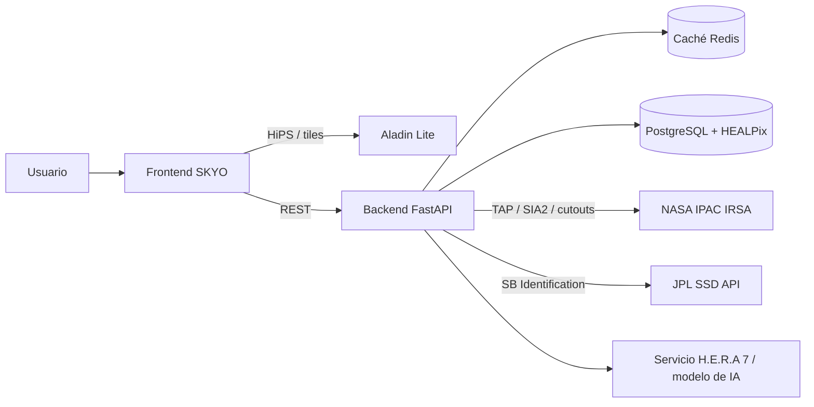

# Arquitectura

## Visión general

## Capas

| Capa | Responsabilidad | Tecnología |
|---|---|---|
| Frontend | Inicio, Explorar, 3D, asistente | HTML/CSS/JS, Canvas 2D, three.js, Aladin Lite |
| API propia | Oculta la complejidad científica; un único punto de entrada | FastAPI |
| Datos | Consultas a IRSA y JPL; recortes de imágenes | pyvo, astroquery, astropy |
| Proceso | Detección de cambios y clasificación | photutils, reproject, scikit-learn o PyTorch |
| Almacenamiento | Detecciones propias y caché | PostgreSQL (columna `healpix`), Redis |

## Decisiones

1. **Todo pasa por el backend.** El navegador nunca habla ADQL. Así hay un solo lugar para caché, límites y cambios de API. Además evita depender de que IRSA acepte llamadas directas desde el navegador (CORS), algo que hay que comprobar.
2. **Caché por celda HEALPix.** El cielo se divide en celdas; la celda es la clave de caché. Usuarios que miran zonas cercanas comparten respuestas.
3. **Zonas precalculadas.** Un conjunto curado de regiones (15 a 20 al inicio) queda procesado de antemano para que la demo no dependa de la latencia de IRSA.
4. **Capas progresivas.** Primero el fondo del cielo (tiles), luego los recortes de SPHEREx y al final las detecciones.
5. **Consultas asíncronas.** El backend devuelve un identificador de tarea; el frontend consulta su estado mientras una animación cubre la espera.
6. **Recortes pequeños.** Se piden recortes de 0.01° a 0.05°, no imágenes completas.

## Contratos de API propuestos

| Método y ruta | Descripción |
|---|---|
| `GET /imagenes?ra&dec&r` | Lista de imágenes espectrales que cubren un punto |
| `GET /recorte?id&ra&dec&tam` | Recorte convertido a PNG listo para mostrar |
| `GET /cambios?region&desde&hasta` | Objetos que se movieron entre dos épocas |
| `GET /objeto/{id}` | Ficha: tipo, posición, movimiento, confianza |
| `POST /hera` | Pregunta al asistente con el contexto de la sección |

Son propuestas de diseño; aún no están implementadas.

## Rendimiento (objetivos)

- Primera imagen útil en menos de 3 segundos en conexión móvil normal.
- Interfaz fluida a 60 cuadros por segundo en galaxia y 3D en un celular de gama media.
- Peso inicial de la página lo más bajo posible (el prototipo actual incrusta el logo y el avatar).
