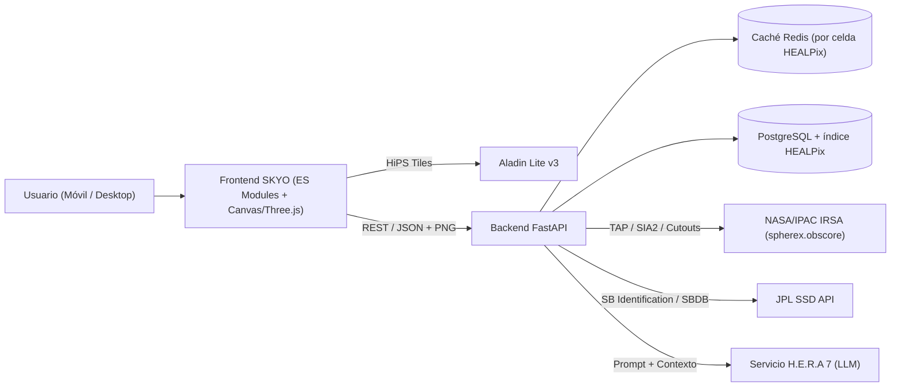

# Especificación Técnica y Funcional — SKYO

> **Versión:** 1.0  
> **Fecha:** 2026-11-13  
> **Contexto:** Reto *«Planeta X y SPHEREx»* — NASA Space Apps Challenge 2026  
> **Fuentes base:** Documentación en `nasa/` (`PROPOSITO.md`, `ARQUITECTURA.md`, `DATOS-Y-APIS.md`, `DETECCION-DE-CAMBIOS.md`, `INTERFAZ-Y-UX.md`, `HERA-7.md`, `ROADMAP.md`) e implementación actual en `index.html` y `assets/`.  
> **Aviso:** SKYO no es un producto ni servicio oficial de la NASA ni de IPAC.

---

## 1. Propósito y Alcance

### 1.1 Problema
1. **Volumen de datos:** Desde 2025, el telescopio espacial **SPHEREx** cartografía todo el cielo cada 6 meses en **102 bandas** del infrarrojo cercano (0.75–5.01 µm, detectores D1–D6), generando datos de más de mil millones de objetos imposible de inspeccionar manualmente.
2. **Barrera técnica:** Las herramientas científicas actuales (IRSA, consultas ADQL/TAP, FITS) exigen conocimientos de coordenadas, catálogos y espectroscopia.
3. **Barrera de idioma y dispositivo:** La mayor parte de los recursos están en inglés y diseñados para escritorio.

### 1.2 Misión del Sistema
Traducir los tres ejes de consulta científica (ubicación, tiempo y banda espectral) a tres preguntas intuitivas en español y optimizadas para móvil: **¿a dónde vamos?**, **¿cuándo?** y **¿con qué luz?**, permitiendo detectar objetos en movimiento entre pasadas de SPHEREx con apoyo del asistente **H.E.R.A 7**.

### 1.3 Público Objetivo y Niveles de Divulgación Progresiva
| Nivel | Perfil | Capacidades expuestas |
|---|---|---|
| **Vuelo** (por defecto) | Estudiantes de colegio, curiosos, público general | Exploración visual, fichas en lenguaje claro, preguntas rápidas a H.E.R.A 7 |
| **Explorador** | Estudiantes universitarios, docentes, aficionados | Filtros por tipo, cambio de época/mes/banda, comparador temporal |
| **Científico** *(planeado)* | Investigadores y usuarios avanzados | Coordenadas ICRS (RA/Dec), desplazamientos en segundos de arco, bandas exactas, exportación/consulta directa |

---

## 2. Estado Actual vs. Alcance Objetivo

| Componente | Estado Actual (Implementado) | Objetivo Especificado (Fases 1–6) |
|---|---|---|
| **Frontend Core** | ES Modules nativos sin bundlers (`index.html`, `assets/js/*`), fuentes WOFF2 locales | Mantener arquitectura sin tooling; integrar visor de cielo real |
| **Inicio (`#inicio`)** | Logo *Eclipse Líquido* en SVG, constelaciones 2D reactivas, subtítulo aleatorio | Mantener + estado de carga optimizado (< 50 ms) |
| **Explorar (`#explorar`)** | Galaxia 2D en Offscreen Canvas, épocas 1–4, meses 1–6, bandas IR Corto/Largo, comparador visual, ficha con `Confirmado`/`Candidato` | Integrar mapa real HiPS (Aladin Lite v3), recortes PNG de SPHEREx y detecciones reales desde backend |
| **Sistema 3D (`#3d`)** | Three.js local con carga diferida (*lazy*) y *dirty rendering*, 8 planetas, cometa y cinturón | Alimentar órbitas de cuerpos menores reales desde JPL SBDB/Horizons |
| **Asistente (`H.E.R.A 7`)** | Burbuja flotante con mensajes por sección y 3 preguntas rápidas fijas | Conectar a LLM vía `POST /hera` con contexto dinámico y guardrails científicos |
| **Backend & Pipeline** | No implementado (datos ilustrativos en `assets/js/data.js`) | API FastAPI + caché Redis/PostgreSQL HEALPix + pipeline IRSA/JPL/photutils |

---

## 3. Requisitos Funcionales (RF)

### 3.1 Navegación y Estructura General
- **RF-01 (Rutas por Hash):** La aplicación debe soportar navegación directa sin recarga mediante `#inicio`, `#explorar` y `#3d`, actualizando `aria-current="page"`.
- **RF-02 (Navegación Adaptativa):** Barra superior en escritorio (`> 720 px`) y barra inferior fija con icono y texto en móvil (`≤ 720 px`), respetando `viewport-fit=cover` (márgenes seguros).
- **RF-03 (Suspensión entre Vistas):** Al salir de una sección, se debe detener su bucle de renderizado y liberar recursos activos de la vista anterior.

### 3.2 Vista Inicio (`#inicio`)
- **RF-04:** Mostrar marca **SKYO** con efecto eclipse en la «O», subtítulo aleatorio del catálogo (`SUBS`) y botones primarios hacia `#explorar` y `#3d`.
- **RF-05:** Renderizar campo estelar/constelaciones en `<canvas>` adaptado a `devicePixelRatio` sin fugas de memoria al redimensionar.

### 3.3 Vista Explorar (`#explorar`) y Mapa Real
- **RF-06 (Filtros):** Filtrar objetos por categoría: `Todos`, `Estrellas`, `Cometas`, `Asteroides`.
- **RF-07 (Ejes Temporales y Espectrales):** Permitir seleccionar Época (pasadas semestrales), Mes de observación (1–6) y Banda espectral (`IR Corto D1–D3: 0.75–2.41 µm` e `IR Largo D4–D6: 2.42–5.01 µm`), más botón de comparación entre épocas (`Comparar épocas`).
- **RF-08 (Ficha de Objeto):** Al seleccionar un cuerpo celeste, mostrar nombre, tipo, insignia de estado (`Confirmado` o `Candidato`), descripción, desplazamiento observado y acción directa *"Preguntar a H.E.R.A 7"*. En móvil (`≤ 720 px`), la ficha se presenta como hoja inferior (*bottom sheet*).
- **RF-09 (Mapa Real HiPS + SPHEREx — Fase 1/2):** Integrar **Aladin Lite v3** con fondo HiPS (DSS color), búsqueda por nombre y superposición progresiva de recortes PNG de SPHEREx (`0.01°` a `0.05°`).
- **RF-10 (Regiones Curadas — Fase 3):** Proveer entre 15 y 20 regiones precalculadas en caché para exploración instantánea en móvil o demos sin depender de la latencia de IRSA.

### 3.4 Detección de Cambios (Backend — Fase 4)
- **RF-11:** Comparar observaciones de una misma región entre dos épocas distintas **siempre dentro de la misma banda espectral**.
- **RF-12:** Clasificar obligatoriamente cada detección en una de tres categorías:
  - **Conocido:** Coincide con un cuerpo menor en JPL *Small-Body Identification*.
  - **Candidato sin identificar:** Presenta desplazamiento `> 2 arcsec` (umbral configurable y documentado) sin coincidencia en JPL y pasa el filtro de artefactos.
  - **Descartado:** Probable rayo cósmico, borde de detector o ruido instrumental.
- **RF-13 (Honestidad Científica):** Ningún objeto sin confirmación JPL podrá etiquetarse como descubrimiento confirmado ni afirmarse como «Planeta X».

### 3.5 Vista Sistema Solar 3D (`#3d`)
- **RF-14:** Cargar `three.min.js` de forma diferida solo al acceder a `#3d`.
- **RF-15:** Proveer enfoques rápidos (`Sistema`, `Cometa`, `Cinturón`), control de pausa/reproducción (`⏸`), slider de velocidad (`0.2x`–`4x`), zoom (`＋`/`－`) y órbita libre por puntero/táctil.

### 3.6 Asistente H.E.R.A 7
- **RF-16:** Flotar de forma persistente (abajo a la derecha en escritorio; arriba a la derecha en móvil para no tapar controles).
- **RF-17 (Modo Local):** Responder inmediatamente a mensajes de bienvenida por ruta y botones rápidos (`¿Qué es SKYO?`, `Dato curioso`, `¿Cómo se usa?`) sin costo de API.
- **RF-18 (Modo Conectado — Fase 5):** Enviar pregunta, ruta actual y contexto (objeto, región, época) a `POST /hera` y devolver respuesta en español breve, clara, con fuentes y distinción explícita entre *confirmado* y *candidato*.

---

## 4. Requisitos No Funcionales (RNF) y Filosofía Ponytail

- **RNF-01 (Cero Tooling y Autonomía Local en Frontend):** HTML5, CSS3 y ES Modules nativos. Tipografías (`Poppins` WOFF2) e imágenes (`hera.webp`, `logo.jpg`) alojadas localmente en `assets/`.
- **RNF-02 (Eficiencia Energética y C-States):**
  - **Offscreen Canvas:** Pre-rasterizar capas estáticas en memoria para evitar cálculos trigonométricos por fotograma.
  - **Dirty Rendering en 3D:** Suspender `requestAnimationFrame` cuando la simulación está pausada y la cámara inmóvil.
  - **Page Visibility API:** Pausar toda animación y redibujado cuando `document.hidden === true`.
- **RNF-03 (Rendimiento):**
  - Primer pintado útil y desvanecimiento de carga inicial en `< 50 ms` (sin retardos artificiales).
  - Primera imagen útil de recorte SPHEREx en `< 3 s` en conexión móvil 4G/normal (apoyado en caché HEALPix y zonas precalculadas).
  - Fluidez objetivo de **60 FPS** en móviles de gama media (anchos validados: `360 px`, `390 px`, `768 px`).
- **RNF-04 (Accesibilidad — WCAG 2.2):**
  - Respeto estricto y reactivo a `prefers-reduced-motion: reduce` (desactivar animaciones, parpadeos y rotación automática).
  - Navegación completa por teclado con foco visible, roles ARIA (`toolbar`, `dialog`, `aria-live="polite"`, `aria-pressed`) y textos alternativos en imágenes.
- **RNF-05 (Seguridad y CORS):** Toda consulta a NASA/IPAC IRSA y JPL debe ejecutarse desde el backend FastAPI; el navegador nunca enviará consultas ADQL directas ni expondrá claves de IA.
- **RNF-06 (Atribución Obligatoria):** Toda vista con datos reales debe mostrar: *«Datos: NASA / IPAC Infrared Science Archive (SPHEREx)»* y *«JPL Solar System Dynamics»* cuando aplique.

---

## 5. Arquitectura del Sistema

### Stack Tecnológico
- **Frontend:** HTML5, CSS3 (`:root` tokens), JavaScript ES2022 (`<script type="module">`), Canvas 2D, `three.min.js` (r128+), Aladin Lite v3 *(revisar compatibilidad GPL v3 antes de definir licencia del repo)*.
- **Backend (FastAPI):** Python 3.12+, `fastapi`, `uvicorn`, `pyvo`, `astroquery`, `astropy`, `astropy-healpix`, `reproject`, `photutils`, `scikit-image`, `scikit-learn` / `PyTorch`.
- **Persistencia y Caché:** PostgreSQL (detecciones indexadas por `healpix`), Redis (respuestas y recortes PNG por `(healpix_cell, epoca, banda)`).

---

## 6. Contratos de API (Backend FastAPI)

| Método y Ruta | Parámetros / Payload | Respuesta | Notas |
|---|---|---|---|
| `GET /imagenes` | `ra` (float), `dec` (float), `r` (float, deg), `banda` (opt) | `{ cell_healpix, imagenes: [{ id, obs_date, banda, wavelength_um, url_recorte }] }` | Consulta `spherex.obscore` vía TAP/SIA2; caché Redis por celda HEALPix |
| `GET /recorte` | `id` (str), `ra` (float), `dec` (float), `tam` (`0.01`–`0.05` deg) | Imagen `image/png` (o `202 Accepted` + `task_id`) | Descarga FITS mínimo desde IRSA, aplica stretch y convierte con `astropy` |
| `GET /cambios` | `region` (str/ra,dec), `desde` (epoca/fecha), `hasta` (epoca/fecha), `banda` | `{ task_id?, estado, detecciones: [...] }` | Ejecución asíncrona si no está en caché; lista objetos movidos |
| `GET /objeto/{id}` | `id` (str) | `{ id, nombre, tipo, estado: "Confirmado"|"Candidato"|"Descartado", ra, dec, desplazamiento_arcsec, confianza, fuente_jpl?, banda }` | Ficha unificada para Frontend y contexto de H.E.R.A 7 |
| `POST /hera` | `{ pregunta, seccion, contexto: { objeto_id?, region?, epoca?, banda? } }` | `{ respuesta, fuentes: [str], es_cache_local: bool }` | Respuestas frecuentes cacheadas localmente; LLM para preguntas abiertas |

### Esquema Mínimo de Detección (PostgreSQL)
- `id` (UUID / PK)
- `healpix` (BIGINT, indexado — orden anidado/ring definido con `astropy-healpix`)
- `ra` (DOUBLE PRECISION), `dec` (DOUBLE PRECISION)
- `banda` (VARCHAR — identificador D1..D6 / rango µm)
- `epoca_a` (DATE), `epoca_b` (DATE)
- `desplazamiento_arcsec` (REAL)
- `categoria` (`conocido` | `candidato` | `descartado`)
- `jpl_designation` (VARCHAR, nullable)
- `confianza` (REAL `0.0`–`1.0`)

---

## 7. Pipeline Científico de Detección de Cambios

1. **Selección y Emparejamiento Espectral:** Validar que Época A y Época B pertenezcan a la misma banda infrarroja de SPHEREx.
2. **Alineación Astrométrica:** Reproyectar el recorte de Época B al marco WCS de Época A usando `reproject`.
3. **Extracción de Fuentes:** Detectar centroides y flujos con `photutils` en ambas épocas.
4. **Cruce Espacial (`astropy.coordinates.SkyCoord`):** Emparejar catálogos (`match_to_catalog_sky`) y marcar como móviles las fuentes con separación `> 2 arcsec` (ajustable según PSF/ruido real de QR/DR).
5. **Cruce con JPL SSD (*SB Identification*):** Verificar si la coordenada en la fecha de observación corresponde a un cometa o asteroide conocido.
6. **Filtrado de Artefactos:** Clasificador ligero (`scikit-learn`/`PyTorch`) que descarta rayos cósmicos, píxeles calientes y artefactos de borde.
7. **Indexación y Exposición:** Almacenar detecciones válidas en PostgreSQL por celda HEALPix y servir en `/cambios`.

---

## 8. Reglas de Comportamiento de H.E.R.A 7

1. **Idioma y Tono:** Español claro, cercano y educativo; explicar términos técnicos al mencionarlos.
2. **Rigor Científico:** Basar respuestas en los datos devueltos por SKYO, diferenciando explícitamente **confirmado** vs **candidato**. Nunca declarar el hallazgo del Planeta X.
3. **Transparencia y Privacidad:** Reconocer cuando un dato no está disponible y no solicitar datos personales del usuario.
4. **Capacidades Futuras (Fase 5):** Navegación asistida (*"llévame al cometa que más se movió"*), misiones guiadas educativas y lectura en voz alta (Web Speech API).

---

## 9. Riesgos Técnicos y Mitigaciones

| Riesgo | Impacto | Mitigación |
|---|---|---|
| Latencia o caída de IRSA en vivo | Alto | Zonas precalculadas (15–20 regiones), caché Redis por celda HEALPix y polling/estado asíncrono con feedback visual |
| Bloqueo CORS en llamadas directas | Alto | Proxy obligatorio mediante backend FastAPI |
| Falsos positivos en detecciones | Alto | Inicio con catálogo-contra-catálogo antes de resta de imágenes, cruce obligatorio con JPL, clasificador de artefactos y etiqueta `Candidato` |
| Conflicto de licencia GPL v3 (Aladin Lite) | Medio | Auditar compatibilidad GPL v3 antes de fijar licencia definitiva de SKYO |
| Costo de inferencia de IA en H.E.R.A 7 | Medio | Cachear respuestas frecuentes localmente en JS/Redis y aplicar *rate limiting* por sesión |

---

## 10. Criterios de Aceptación del MVP (Hackathon)

1. **Mapa real navegable:** Búsqueda por nombre y visualización sobre cielo real (Aladin Lite / HiPS) funcional en móvil (`360 px`) y escritorio.
2. **Datos reales de SPHEREx:** Al menos **5 a 10 regiones curadas** sirviendo recortes PNG reales desde IRSA vía backend FastAPI en `< 3 s`.
3. **Caso de cambio de extremo a extremo:** Demostración reproducible recuperando un objeto menor conocido entre dos fechas reales mediante el pipeline y cruce JPL.
4. **H.E.R.A 7 útil y seguro:** Respuestas contextuales en todas las secciones respetando las reglas científicas y sin errores de accesibilidad crítica.
5. **Cumplimiento Ponytail:** Cero bucles activos en segundo plano cuando la pestaña está oculta y 60 FPS sostenidos en vistas interactivas.
