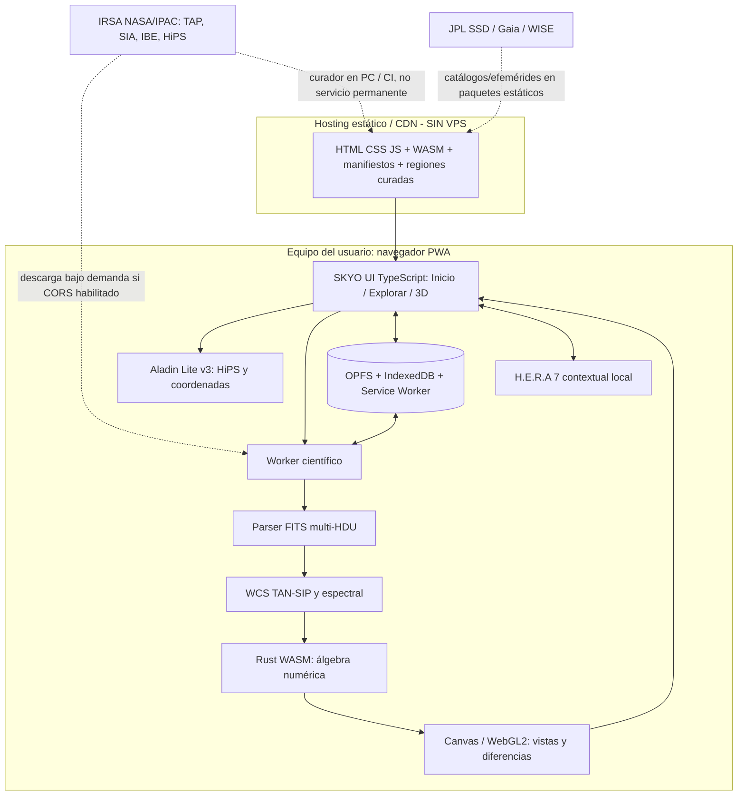
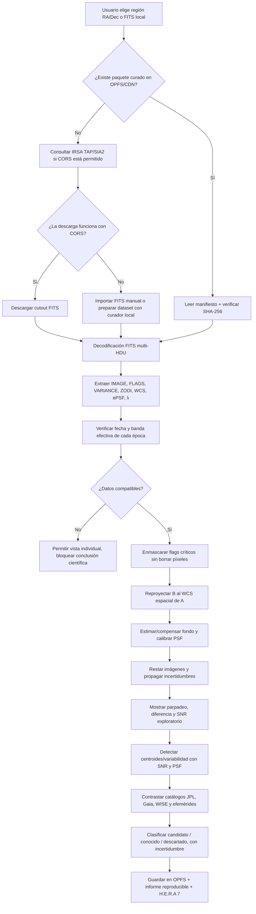

# SKYO 2.0 — Especificación técnica, científica y funcional

> **Estado:** PROPUESTA de arquitectura v2.0 + prototipo inicial ejecutable localmente.  
> **Fecha de corte de investigación:** 2026-11-13 (America/Lima).  
> **Proyecto base:** `SPEC(1).md`, SKYO v1.0 del 2026-11-13.  
> **Objetivo:** NASA Space Apps Challenge 2026, «Planet X and SPHEREx».  
> **Naturaleza:** aplicación web local-first; **no** es un producto oficial de NASA, JPL ni IPAC.

## 0. Resumen ejecutivo y decisiones de arquitectura

SKYO mantiene su identidad visual, sus tres preguntas (**¿a dónde vamos?, ¿cuándo?, ¿con qué luz?**), el sistema solar 3D y H.E.R.A 7. Sustituye el **backend VPS propuesto en v1.0** por una aplicación web estática que ejecuta procesamiento de imágenes en el **navegador** del visitante, con **Rust → WebAssembly (WASM), Web Workers, FITS, WCS y caché local**. **Node.js es una herramienta de desarrollo y compilación**, no un proceso de servidor permanentemente requerido para usuarios.

### Decisiones aprobadas para proponer al equipo (ADR)

| ID | Decisión | Motivo | Consideración |
|---|---|---|---|
| ADR-01 | **Vite + TypeScript + componentes DOM/ES Modules** | Preserva la estructura actual, optimiza assets y permite migración gradual desde JS nativo | Lit opcional para componentes complejos; evitar reescribir SKYO a React/Svelte antes del MVP |
| ADR-02 | **Rust / wasm-bindgen** para kernels numéricos | Memoria tipada, portabilidad, lógica científica verificable | WASM **no** aporta automáticamente más rendimiento que JS para cada operación; medir |
| ADR-03 | **Web Worker** exclusivo para procesar FITS/WCS | No congelar interfaz ni animaciones | Usar `ArrayBuffer` transferibles, no copias masivas |
| ADR-04 | **Canvas 2D + WebGL2**, WebGPU optativo | Compatibilidad móvil; coloreado o compositado GPU si lo justifica un benchmark | Pérdida de contexto GPU debe admitir fallback |
| ADR-05 | **Aladin Lite v3** para mapa real | HiPS, coordenadas, overlays y soporte WebGL2 | A fecha de revisión el repositorio publica LGPL-3.0-or-later; revisar versión/obligaciones, mantener atribución/logo |
| ADR-06 | **Three.js lazy** en `#3d` | Reusar implementación actual y evitar cargar geometría en Inicio | 3D no debe consumir recursos al estar oculto |
| ADR-07 | **OPFS** para FITS/cache y **IndexedDB** para índices | Datos localmente, sin Redis/PostgreSQL | Cupos/evicción dependen del navegador; botones de limpieza/exportación |
| ADR-08 | **PWA + CDN estático** | No requiere VPS o backend propio | Se necesita conexión para descargas NASA no almacenadas |
| ADR-09 | **IRSA DR1 + QR3** como fuentes primarias | DR1 reprocesa QR2 y debe usarse con QR3 | No combinar observaciones espectralmente incompatibles |
| ADR-10 | **H.E.R.A 7 primero determinista y contextual offline** | Respuestas rápidas con fuentes, sin credenciales ni cobro por API | LLM local es mejora opcional, no requisito del hackatón |

**Restricciones no negociables:** no inventar observaciones ni fechas; no etiquetar un candidato como «Planeta X»; no alterar FITS originales; no deducir movimientos por una diferencia sin calidad y validación. La viabilidad de consultas CORS directas de IRSA **no ha sido comprobada** desde este entorno: usar paquetes curados alojados en el mismo origen y carga manual FITS como rutas fiables.

## 1. Trazabilidad contra el SPEC v1.0

| Área de v1.0 | Conservar | Modificar en v2.0 |
|---|---|---|
| `#inicio` (RF-01 a 05) | Logo, constelaciones, navegación hash, accesibilidad | Componentes TS cargados de forma diferida; contenido inicial sin procesamiento pesado |
| `#explorar` (RF-06 a 10) | Filtros, tiempos, bandas, bottom sheet y comparación | Distinguir visualización artística vs observación real; Aladin; pipeline FITS local; 102 canales en modo cubo, 6 detectores en modo época |
| Detección (RF-11 a 13) | Estados `Conocido/Candidato/Descartado`, responsabilidad científica | Reemplazar umbral fijo `>2 arcsec` por incertidumbre/sig. astrométrica dependiente de PSF/SNR; exigir validación WCS y espectral |
| `#3d` (RF-14 a 15) | Three.js diferido y dirty rendering | Órbitas JPL como carga optativa de manifiestos estáticos; interfaz puede operar offline con datos precargados |
| H.E.R.A 7 (RF-16 a 18) | Personaje, textos locales, contextualidad | Sin `POST /hera` obligatorio; knowledge base local con contexto de análisis y evidencias; LLM local solo si dispositivo permite |
| Infraestructura | Atribución NASA/IPAC, WCAG y modo móvil | Eliminar VPS, FastAPI, Redis, Postgres, servicios `/imagenes` `/recorte` `/cambios` `/hera` como requisitos de producción |

La especificación original describe el frontend con ES Modules, Canvas y Three.js, y deja backend/datos reales pendientes. **No se ha revisado el código fuente original**: la ruta de migración se ajustará cuando esté disponible `index.html` y la carpeta `assets/`.

## 2. Arquitectura de ejecución



**Importante:** «Sin VPS» ≠ «sin Internet» o «sin hosting». Una página pública necesita archivos estáticos publicados en algún lugar. Una PWA previamente instalada puede operar sin conexión **solo sobre datos almacenados**. Cuando IRSA no permite CORS para un tipo de recurso, ningún WASM puede saltarse esa protección: recurrir a un archivo local del usuario o un paquete derivado servido en el mismo origen.

### Distribución de tareas

- **Main Thread:** interfaz, teclado, accesibilidad, navegación, estado y los controles visibles. Evitar cálculos > ~8 ms por frame.
- **Worker 1:** lectura de FITS, memoria de ROI, máscaras y proyección espacial, carga del WASM.
- **Worker 2 (futuro):** búsqueda de candidatos/ePSF/calibración más costosa; no activar simultáneamente en móviles de gama media sin medir.
- **GPU:** render de HiPS y 3D, y opcional coloreado/composición por textura. Las matrices originales nunca cambian al modificar colores.
- **OPFS:** recortes FITS binarios, productos intermedios y manifiestos; **IndexedDB:** metadatos de búsqueda y claves de índice.
- **Service Worker:** shell offline y recursos estáticos previamente seleccionados; **no** precachear automáticamente archivos NASA gigantes.

## 3. Modelo de datos: producto científico real

Una imagen individual SPHEREx L2 corresponde a una observación particular de un detector. El tutorial oficial describe un FITS de múltiples extensiones:

| HDU | Tipo | Función en SKYO | Nota científica |
|---|---|---|---|
| `PRIMARY` | Header | Versión y procedencia | `DATE` puede indicar procesamiento, **no** fecha de observación |
| `IMAGE` | `float32` | Radiancia calibrada (MJy/sr) | Contiene fondo zodiacal: no está sustraído |
| `FLAGS` | CompImageHDU/bitmap int32 | Máscara de calidad | En datos originales puede estar **comprimida**; `MSKNnnnn`/`MSKDnnnn` definen bits |
| `VARIANCE` | `float32` | Incertidumbre (MJy/sr)² | Tras interpolación, covarianzas requieren tratamiento adicional |
| `ZODI` | `float32` | Modelo de brillo zodiacal | Mantener por separado; sustraer solo como opción documentada |
| `EPSF` | Tabla | Perfil efectivo de fuentes por ubicación | 441 regiones (21 × 21), modelos subpíxel; crítico para detección fina |
| `WCS-WAVE` | Tabla binaria | Centro λ y ancho de banda según píxel | LVF: dos píxeles del **mismo detector** pueden medir λ distintos |

IRSA publica DR1 (noviembre de 2026) y recomienda utilizar DR1 + QR3 conjuntamente. Los **102 canales** corresponden al cubo/mosaico; **no** son 102 imágenes independientes de la misma época. El cubo HiPS all-sky sirve para seleccionar λ, mientras que los L2 con tiempo individual sirven para detectar cambios. Los cubos FITS HEALPix completos pueden rondar ~300 MB, inadecuados para descargas iniciales en móvil.

### DTO sugerido (TypeScript)

```ts
type ImageSource = 'NASA-IPAC-DR1' | 'NASA-IPAC-QR3' | 'DERIVED-LOCAL' | 'SYNTHETIC';
type QualityLevel = 'raw' | 'visual-only' | 'comparative' | 'validated';
interface SkyoObservation {
  id: string;
  localFile: string;
  originUrl?: string;
  source: ImageSource;
  sha256: string;                  // integridad de artefacto actual
  sourceSha256?: string;            // hash binario IRSA original, si existe
  detector: 1|2|3|4|5|6;
  raDeg: number;
  decDeg: number;
  mjd: number;                    // fecha real desde TAP p.time_bounds_lower
  observedUtc: string;
  wavelengthCenterUm?: number;    // centro de ROI, NO mapa por píxel
  bandwidthUm?: number;
  wavelengthMapVerified: boolean;
  wcsSpatialVerified: boolean;
  psfFwhmArcsec?: number;
  flagsAvailable: boolean;
  varianceAvailable: boolean;
  dataRelease: 'DR1'|'QR3';
  quality: QualityLevel;
}
interface SkyoDifference {
  observationA: string;
  observationB: string;
  wcsReprojected: boolean;
  spectralCompatible: boolean;
  qualityMaskApplied: boolean;
  validPixels: number;
  skyOffsetMJySr: number;
  significanceCalibrated: boolean;
  status: 'exploratory'|'candidate-unverified'|'catalog-matched'|'discarded';
  warnings: string[];
}
```

### Esquema de un dataset estático

```text
web/datasets/m101/
  manifest.json         # metadatos, versiones, fecha MJD, λ, hashes, origen
  spherex_d2_001.fits   # recorte derivado preservando IMAGE/VARIANCE, FLAGS sin compresión
  spherex_d2_002.fits
```

**Proveniencia:** en pantalla mostrar siempre instrumento, colección, fecha, detector, λ, estado de calidad, identificador/URL y aclaración «Datos: NASA/IPAC Infrared Science Archive (SPHEREx)». Citar el DOI DR1 imágenes `10.26131/IRSA678` y cubo `10.26131/IRSA679` cuando corresponda.

## 4. Pipeline de datos completo (ingesta → análisis local)



### Etapas, implementación y controles

**P0. Descubrimiento de observaciones.** Consultar `spherex.artifact` + `spherex.plane` mediante TAP en un proceso voluntario de curación o desde navegador solo cuando CORS sea viable. Filtrar `energy_bandpassname` por detector; guardar `time_bounds_lower` (MJD). Evitar confundir cabecera `DATE` del producto con tiempo de observación. Para vistas globales usar tiles HiPS, no descargar 102 capas FITS enormes.

**P1. Recorte en lugar de archivo completo.** Usar URLs IBE con `?center=<ra>,<dec>d&size=<lado_deg>`. Empezar con campo ~0.1° (ajustar según disponibilidad, densidad y móvil); varios píxeles relevantes deben quedar dentro de la región. Demostración móvil: 128–256 px; techo inicial para comparación 512×512. En NASA, la cobertura real y el tamaño final se verifican después de descargar.

**P2. Lectura FITS.** Leer bloque 2880, cabeceras de 80 caracteres, múltiples HDU, BIG-ENDIAN, `BITPIX`, `BSCALE`/`BZERO`, NaN. El lector básico del prototipo admite IMAGE/VARIANCE/ZODI/FLAGS **sin compresión**, pero no descomprime `FLAGS` tile-compressed originales. La curación offline con `astropy.io.fits` los convierte a un HDU de bandera no comprimido; para soporte autónomo de FITS originales añadir lector Rust puro compatible WASM (p. ej. `fitsio-pure` o `fitsy`) **después** de verificar funciones de compresión y WCS de estos productos.

**P3. Calidad de píxeles.** Leer `MSKNnnnn` y `MSKDnnnn` del header de FLAGS; configurar bits críticos (HOT, COLD, NONFUNC, TRANSIENT, OVERFLOW, XTALK, GHOST, MISSING, HALO, etc.) según documentación instrumental. Nunca marcar por defecto SOURCE como malo. Conservar NaN y una máscara binaria junto a la imagen original; visualizar zonas descartadas sin interpolación destructiva.

**P4. Filtro espectral.** Comparar `DETECTOR`, λ central y Δλ en la ROI; la comparación **científica** debe verificar λ/Δλ por posición mediante `WCS-WAVE` (o una validación equivalente precomputada). Igual detector = filtro preliminar, no prueba suficiente. Si falta WCS espectral, habilitar solo `comparación exploratoria`. Si las λ no se solapan: bloquear resta interpretativa de movimiento.

**P5. Registro astrométrico.** Reproyectar cada píxel de destino de A a B utilizando WCS espacial `RA---TAN-SIP`/`DEC--TAN-SIP`. Conservar coordenadas 1-based FITS en la conversión, aunque Canvas/JS use 0-based. Validar residuales y convergencia frente a `astropy.wcs` con observaciones reales; rechazar tipos WCS desconocidos en lugar de ignorar distorsión. En prototipo se implementa interpolación bilineal, suficiente para *visualización exploratoria*, no fotometría de alta precisión.

**P6. Fondo y señal.** `IMAGE` incluye luz zodiacal: conservar `IMAGE` original; exponer opción `IMAGE - ZODI` solo si se documenta que se aplica el modelo y sus incertidumbres. Para cambios, estimar offset de fondo por mediana robusta sobre píxeles válidos fuera de fuentes brillantes. Un ajuste diferencial plano/no uniforme, escalado y coincidencia PSF son mejoras necesarias para análisis científico de calidad.

**P7. Diferencias y varianzas.** `D(x,y)=A(x,y)-B_reproj(x,y)-offset`. La aproximación inicial `sigma_D=sqrt(Var_A + Var_B_reproj)` permite ver un mapa SNR, con **advertencia explícita** sobre correlaciones introducidas por remuestreo, calibración de fondo y PSF. No usar SNR calculado así como probabilidad de descubrimiento. Escalado de visualización `asinh` y paleta divergente son solo de display.

**P8. Objetos móviles.** Requiere centroides/ePSF por época, asociación multi-época, SNR, rechazo de artefactos, detección repetida, astrometría de precisión y falsos positivos cuantificados. El umbral original de `>2 arcsec` **no es un criterio suficiente**: comparar con PSF (en tutorial aparece FWHM ~7.5" en una observación), escala de píxel, incertidumbres y delta de tiempo. Mostrar movimiento con error angular y, si hay suficientes observaciones, tasa en arcsec/día. **Esta etapa no está implementada en el prototipo entregado**.

**P9. Identificación independiente.** Cruce contra JPL (cuerpos menores) con fecha y geometría de observación correctas; Gaia para estrellas de alto movimiento propio; WISE como historia temporal complementaria. No se puede identificar un objeto solo porque no coincida con JPL, pues podría ser estrella, enana marrón o artefacto. Guardar evidencias y versión del catálogo. **No** hay detección de Planeta X confirmada por SKYO.

**P10. Informe y conversación.** Guardar procedencia de cada recorte, hash, máscara aplicada, software/versión WASM, fechas, λ, WCS, offset, incertidumbres, estado científico. H.E.R.A 7 solo explica esos datos existentes y distingue demostración sintética, análisis exploratorio y resultados verificados.

## 5. Pipeline implementado en el paquete adjunto (alcance real)

| Componente | Implementación de la entrega | Nivel de verificación |
|---|---|---|
| Lector FITS 2D multi-HDU | `web/src/fits.js`, IMAGE/FLAGS no comprimidas/VARIANCE/ZODI | Pruebas Node con FITS sintéticos |
| Máscara por bitmap MSKN | `buildQualityMask` | Test con bit HOT simulado |
| WCS espacial TAN-SIP | `web/src/wcs.js`, ida/vuelta, remuestreo bilineal | Tests matemáticos con cabeceras sintéticas; **no comparado aún con Astropy real** |
| Diferencia + offset + varianza | `web/src/pipeline.js` + `wasm/src/lib.rs` | Algoritmo JS comprobado; Rust **pendiente de compilación** |
| Render de FITS | `web/src/render.js`, escala asinh y mapa divergente | Se verificó el tamaño/estructura de salida; QA visual en navegador pendiente |
| Web Worker | `web/worker.js` | Código construido; recorrido integral de navegador pendiente |
| OPFS / PWA | `web/src/opfs.js` + `web/sw.js` | Código escrito; no probado en distintos móviles |
| Curador IRSA | `tools/curate_irsa.py` | Sintaxis compilada, **no probado contra IRSA** |
| Detección ePSF y JPL | **No implementado** | Futuro tras validación |

Todos los productos de ejemplo `web/demo/epoca_*.fits` son **sintéticos**; no provienen de NASA. La herramienta indica explícitamente el carácter exploratorio de sus diferencias. Un resultado con estos archivos **jamás** equivale a una detección astronómica.

## 6. Diseño de frontend y experiencia de usuario

### Navegación existente

- **Inicio:** marca SKYO y vista orbital ilustrativa de carga liviana; CTA «Explorar el cielo real». Sin descargas FITS al abrir Inicio.
- **Explorar:** mapa Aladin HiPS con tres controles fijos: **Lugar**, **Tiempo**, **Luz**. En modo Vuelo mostrar nombres y explicaciones; en modo Explorador activar fechas/reproductor; en modo Científico mostrar WCS, λ, incertidumbres, máscaras y descarga.
- **Sistema 3D:** Three.js con carga diferida; efemérides reales de objetos menores desde manifestos precargados, nunca órbitas inventadas etiquetadas como reales.
- **Laboratorio (subsección de Explorar):** panel 2×2 observación A/B, mapa diferencia y tarjetas de procedencia; en móvil usar columnas apiladas/bottom sheet; reproducción «blink» solo si dos imágenes reales compatibles. El prototipo `web/index.html` contiene este laboratorio como miniapp independiente para integrar más tarde en `#explorar` del frontend original.
- **H.E.R.A 7:** fichas locales en español y explicación contextual basada en estructuras verificadas. Un LLM de ejecución local (p. ej. WebGPU) **no es parte del MVP** por latencia, consumo de RAM y tamaño de modelo.

### Sistema visual premium y eficiente

| Token | Valor / recomendación |
|---|---|
| Fondo espacial | `#080D1B` con dos gradientes suaves estáticos |
| Superficie | `#111A2C` + bordes translúcidos de contraste comprobado |
| Acción primaria | Azul cian claro `#8DE8FA`; alternativa cálida `#F4BC74` para alertas de intensidad |
| Tipografía | Poppins WOFF2 local actual; limitar pesos a 2–3 y precargar solo crítico |
| Layout | Controles táctiles >= 44×44 px, 16 px de margen móvil y bottom sheet responsive |
| Movimiento | Transiciones CSS ≤ 200 ms, sin animaciones permanentes en pestaña oculta |
| Científico | Escalado configurable (linear/log/asinh), botón «bruto vs visual», máscara de banderas y barra λ verificable |
| Sostenibilidad | `requestAnimationFrame` solo por interacción; GPU Canvas/3D apagada fuera de viewport |

Prohibido confundir mapas de falso color con fotografías visibles; cada vista indicará si es **cubo mosaico**, **imagen L2 de una fecha** o **ilustración**. Nunca aplicar IA generativa para «rellenar» píxeles usados en una detección.

### Accesibilidad

- WCAG 2.2 AA objetivo, navegación completa por teclado, controles con nombre accesible, estado en `aria-live`.
- `prefers-reduced-motion` debe desactivar reproducción automática de blink y rotación 3D; ofrecer botón manual paso a paso.
- Paletas de diferencias apoyadas por signos/leyendas, no solo color; permitir escala de grises.
- Lector de pantalla debe conocer fecha, detector, región, calidad, errores y fuente NASA del dato.

## 7. Contratos de módulos locales, sustitutos de las rutas REST de v1.0

```ts
interface DataAdapter {
  search(query: {raDeg:number;decDeg:number;radiusDeg:number;detector?:number}): Promise<SkyoObservation[]>;
  load(ref: SkyoObservation, signal?: AbortSignal): Promise<ArrayBuffer>;
}
interface ScientificWorkerClient {
  decodeFits(bytes: ArrayBuffer): Promise<FitsDataset>;
  renderLayer(layer: 'IMAGE'|'FLAGS'|'VARIANCE'|'ZODI'): Promise<ImageBitmap|Uint8ClampedArray>;
  compare(a: string, b: string, config: CompareConfig): Promise<SkyoDifference>;
  cancel(jobId: string): void;
}
interface LocalDataStore {
  putBinary(key:string,bytes:ArrayBuffer,provenance:object): Promise<void>;
  getBinary(key:string): Promise<ArrayBuffer|null>;
  quota(): Promise<{usage:number;quota:number}>;
  evict(keys:string[]): Promise<void>;
}
```

Reemplazos:

- `GET /imagenes` → `CatalogRepository.search()` sobre manifiesto precalculado o consulta TAP cliente **solo si CORS funciona**.
- `GET /recorte` → `DataAdapter.load()` + `ScientificWorker.decodeFits()` + `Renderer.draw()`. Descarga a NASA bajo demanda o paquete estático sin proxy.
- `GET /cambios` → `ScientificWorker.compare()` y progreso/cancelación por `postMessage`.
- `GET /objeto/{id}` → catálogo local + cache JPL/Gaia con fuente y época.
- `POST /hera` → `HeraLocal.respond(context)`; inferencia externa **no requerida**.

**Estado del usuario:** usar `observation: loading | ready | incompatible | error`; `analysis: idle | validating | registering | subtracting | exploratory | validated | error`. Incluir pausa/cancelación; no dejar estados ambiguos durante análisis.

## 8. Almacenamiento, CORS, conectividad y seguridad

1. **Hosting estático:** Cloudflare Pages, Netlify o GitHub Pages, sin procesos Node/FastAPI en producción.
2. **Paquetes de regiones curadas:** un curador puede ejecutarse en una laptop del equipo (o CI temporal) para obtener recortes de NASA con Astropy y reempaquetar `FLAGS` para su lectura. El procesamiento interactivo ocurre después en el dispositivo visitante. Esto no es un VPS.
3. **Modo en vivo:** intentar `fetch` directo a IRSA solo después de verificar cabeceras CORS del endpoint exacto desde el origen publicado. **No se pudo comprobar CORS aquí**; no prometerlo como ruta principal.
4. **Carga manual:** aceptar archivos FITS descargados por el usuario; sin subirlos a ningún servidor. Restringir tamaños, tipos, número de HDUs, dimensiones y longitud para evitar errores/memoria excesiva.
5. **OPFS:** guardado bajo consentimiento explícito del usuario; limitar presupuesto según `navigator.storage.estimate()` y permitir eliminación. El navegador puede eliminar datos por cuota o limpieza; exportación del usuario como respaldo.
6. **Service Worker:** cache solo de shell y recursos curados pequeños; no hacer fetch/prefetch masivo sin permiso. Alojamiento HTTPS obligatorio para instalación PWA y OPFS en contextos reales (localhost es excepción de desarrollo).
7. **WASM threads:** comenzar **sin threads**. `SharedArrayBuffer` y WASM multithreading requieren COOP+COEP/cross-origin isolation y pueden bloquear recursos de terceros como Aladin HiPS. SIMD de un solo hilo y Web Worker bastan para MVP; revisar medido.
8. **Integridad:** hashes SHA-256 por observación; registrar tanto original NASA como derivado. Contratos versionados y bitmasks documentados.
9. **Licencias:** Aladin Lite actualmente anuncia LGPL-3.0-or-later en README/repositorio; comprobar licencia y notices del release que se distribuya. Three.js/FITS crates según licencias elegidas. **No es asesoría jurídica**.

## 9. Presupuestos de rendimiento, batería y memoria

Estos son **objetivos a medir**, no resultados garantizados.

| Métrica | Objetivo | Prueba |
|---|---|---|
| LCP de UI precargada | ≤ 2.5 s en móvil medio | Lighthouse, red 4G simulada, p75 |
| INP | ≤ 200 ms | Web Vitals/DevTools |
| CLS | ≤ 0.1 | Lighthouse |
| Primera vista FITS curada pequeña | ≤ 1.5 s desde caché local | Android gama media; archivo 128×128 / 256×256 |
| Diferencia 128×128 en caché | objetivo < 150 ms worker | Validar en Android real; no extrapolar Node |
| Diferencia 512×512 | sin bloquear UI, tolerar segundos | Tiempo real + memoria en navegador |
| Canvas/3D cuando activos | 60 FPS objetivo | FPS y long tasks; bajar render scale si es necesario |
| Fuera de vista / pestaña oculta | 0 RAF/animaciones permanentes | Performance tracing |
| Tamaño máximo para comparar inicialmente | 512×512 por época | Rechazar recortes mayores con instrucciones |
| Datos iniciales | 2–5 regiones pequeñas; expansión a 10 | Medir cuota hosting y descarga móvil |

Optimizar primero con perfiles. Costes potenciales: parseo de FITS big-endian, alineación por píxel, asignaciones de nuevos `Float32Array`, copias JS↔WASM, y conversión de matrices a RGBA. Reusar buffers cuando sea posible y pasar `ArrayBuffer` como transferable. Mantener una política móvil de reducción de área ROI bajo aviso, **sin afirmar detección en datos degradados**.

## 10. Roadmap de migración concreta

| Etapa | Alcance | Prueba de aceptación |
|---|---|---|
| M0. Copia y compatibilidad | Preservar `index.html` y `assets/`; crear rama `skyo-v2-local` | UI visual v1 sigue disponible |
| M1. Node + Vite sin reescritura | Añadir scripts, TS progresivo y salida estática | `npm run build`; rutas hash mantienen estado |
| M2. Motor local MVP | Integrar `web/worker.js` + parser de FITS + preview | Archivo sintético se abre, UI no se bloquea |
| M3. Dataset NASA curado | Ejecutar `tools/curate_irsa.py` desde PC con internet; guardar 2–5 ROI auténticas | IRSA URL/hashes/fechas, FLAGS y VARIANCE visibles |
| M4. Registro astronómico | Validar `TAN-SIP` frente a Astropy real; comprobar máscara y WCS espectral | Residuales en píxeles/arcsec documentados, pares compatibles |
| M5. Comparador real | Blink, A/B, diferencia, cronología, fuente y estado explícito | Demostración reproducible con **dos fechas reales** |
| M6. Ciencia de candidatos | ePSF/fotometría, JPL/Gaia, controles SNR y revisiones | Validación cruzada con datos conocidos y tasa de falsos positivos |
| M7. H.E.R.A 7 + 3D | Asistente contextual y geometría JPL real opcional | No atribuye hallazgos sin evidencia; consumo en pausa cero |
| M8. PWA entrega | OPFS, offline y despliegue estático | Funciona offline para recortes previamente descargados |

**Orden recomendable para la presentación:** M0–M5 primero. Aceptar un comparador real de calidad antes que una supuesta IA que «descubre Planet X» sin validación.

## 11. Nueva matriz de criterios de aceptación

- [ ] Los archivos originales de SKYO no se han modificado hasta disponer del frontend para integrar; cambios son incrementales.
- [x] Existe demo local de lectura FITS y diferencia sintética (tests Node) separada de la app original.
- [ ] `Rust WASM` compilado con `wasm-pack` y resultado numérico comparado bit a bit/tolerancia frente a JS.
- [ ] UI probada visualmente en Chrome/Firefox/Safari y Android 360/390px con datos reales.
- [ ] Dos observaciones reales de SPHEREx DR1/QR3 de **misma región y λ compatible**.
- [ ] WCS TAN-SIP validado frente a Astropy con headers y coordenadas de SPHEREx.
- [ ] `FLAGS` descomprimida, leída y aplicada, con definiciones originales; no eliminar `SOURCE`.
- [ ] `VARIANCE` cargada y utilizada; advertencia para correlación postinterpolación.
- [ ] WCS-WAVE contrastado por píxel; λ y anchura reales disponibles o se bloquea afirmación científica.
- [ ] Diferencias, máscaras y estados preservan integridad y procedencia de observaciones.
- [ ] Blink/decalaje y export JSON de análisis local, sin enviar datos de usuarios.
- [ ] JPL/Gaia consultados con fecha y geometría correctas antes de decir «Conocido».
- [ ] H.E.R.A 7 no inventa medidas y señala las limitaciones de cada análisis.
- [ ] OPFS/PWA probados con cortes de red y gestión de cuotas.
- [ ] Publicación desde hosting estático sin VPS; licencias/atribuciones auditadas.

## 12. Riesgos y bloqueantes actuales

| Riesgo | Impacto | Medida |
|---|---|---|
| CORS IRSA no compatible con fetch desde navegador | Alto | Recortes curados del mismo origen + archivo manual; verificar endpoint antes de habilitar modo directo |
| FLAGS originales tile-compressed | Alto | Curación inicial con Astropy para generar FLAGS no comprimida; evaluar biblioteca FITS Rust WASM |
| WCS-WAVE FITS no soportado por lectores simples | Alto | Metadatos científicos por ROI curados, validar mapa espectral pixel a pixel antes de detectar |
| WCS TAN-SIP incorrecto en un FITS real | Alto | Test cruzado vs Astropy con observaciones reales y mapa de residuales |
| Imágenes de igual detector pero distinta λ | Alto | Pares elegidos por λ/Δλ reales y cobertura espacial, no solo D1…D6 |
| 2" umbral no robusto | Alto | Usar incertidumbre por fuente, ePSF, SNR, múltiples fechas y control de artefactos |
| Carga de cientos de MB agota RAM móvil | Alto | Recortes, límite 512², worker y cuota; no cargar cube 300MB en móvil |
| GPL/LGPL o notices incumplidos | Medio | Revisar rama/tag exacta de Aladin, conservar avisos |
| WebGPU/LLM local consume batería/RAM | Medio | No usar por defecto; HERA determinista |
| Persistencia OPFS no garantizada | Medio | Botón exportar y mensajes sobre limpieza del navegador |

## 13. Fuentes consultadas (oficiales y técnicas)

1. NASA/IPAC IRSA, [SPHEREx Mission & Releases](https://irsa.ipac.caltech.edu/Missions/spherex.html).
2. NASA/IPAC IRSA, [DR1 Overview](https://irsa.ipac.caltech.edu/data/SPHEREx/docs/overview_dr1.html).
3. IRSA Tutorials, [Introduction to SPHEREx Spectral Images](https://caltech-ipac.github.io/irsa-tutorials/spherex-intro/): IMAGE, FLAGS, VARIANCE, ZODI, EPSF, WCS-WAVE.
4. IRSA Tutorials, [Download a collection of SPHEREx Spectral Image cutouts](https://caltech-ipac.github.io/irsa-tutorials/spherex-cutouts/): TAP `spherex.artifact` y `spherex.plane`, tiempos y recortes.
5. IRSA Tutorials, [SPHEREx HiPS All-Sky Mosaic Cubes](https://caltech-ipac.github.io/irsa-tutorials/spherex-hipscube/): 102 canales, ~300MB por cubo HEALPix FITS.
6. CDS, [Aladin Lite v3](https://github.com/cds-astro/aladin-lite) y [licencia actual](https://github.com/cds-astro/aladin-lite/blob/master/LICENSE).
7. MDN, [WebAssembly](https://developer.mozilla.org/en-US/docs/WebAssembly), [Web Workers](https://developer.mozilla.org/en-US/docs/Web/API/Web_Workers_API/Using_web_workers), [OPFS](https://developer.mozilla.org/en-US/docs/Web/API/File_System_API/Origin_private_file_system) y [COOP/COEP](https://developer.mozilla.org/en-US/docs/Web/API/Window/crossOriginIsolated).
8. [Vite build for static hosting](https://vite.dev/guide/build.html).
9. [fitsio-pure](https://docs.rs/crate/fitsio-pure/latest) y [fitsy](https://docs.rs/fitsy/latest/fitsy/) como **candidatos a evaluar**, no declarados compatibles sin test real.
10. `SPEC(1).md`, aportado por el proyecto, v1.0 2026-11-13 (base de la trazabilidad, no fuente NASA).

---

### Notas sobre verificación de esta entrega

- El código JavaScript del pipeline ha ejecutado tests Node con FITS sintéticos generados localmente, incluida reproyección TAN-SIP y salida de diferencias.
- Se comprobó sintaxis del curador Python; **no** se conectó a IRSA desde este entorno porque el runtime no pudo resolver ese host.
- El kernel Rust es código fuente de referencia y no se pudo compilar aquí: `cargo`/`rustc`/`wasm-pack` no están instalados. El prototipo cae a JavaScript si no encuentra WASM; la promesa de rendimiento WASM se evaluará después de compilarlo en un equipo del usuario.
- Los 8 tests de Node no demuestran precisión astronómica sobre datos reales. No se ha certificado interoperabilidad completa de FITS, espectral WCS, ePSF, compresión original ni detección de objetos.
